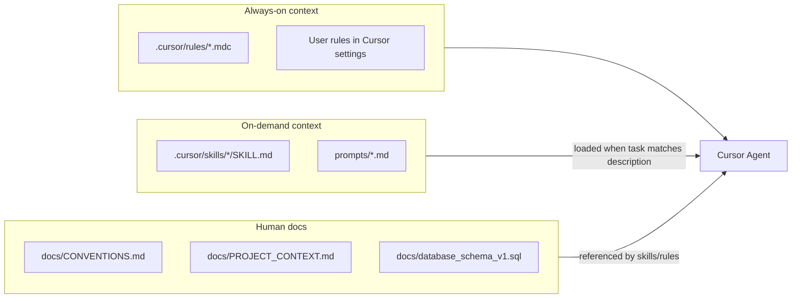

# Cursor AI Skills for MTF

Reference document — rationale and setup for Cursor rules and skills in this repo.
**Implementation:** completed (see [.cursor/rules/](../.cursor/rules/) and [.cursor/skills/](../.cursor/skills/)).

---

## Are Cursor AI Skills Applicable Here?

**Short answer: Yes.** Skills are a good fit for `deevo_mt_framework_backend`, especially because this repo has **domain-specific workflows** that generic AI knowledge does not cover (SSMS-only DDL, no Alembic, MTF layering, error-code shape, integration-test gating).

You do **not** need skills to start developing—the app already runs and tests pass. Skills pay off when you want the agent to **reliably repeat multi-step procedures** without re-explaining context each session.

---

## What Skills Are (vs What You Already Have)

| Mechanism | Purpose | This repo |
|-----------|---------|-----------|
| [CONVENTIONS.md](CONVENTIONS.md) | Authoritative coding rules (~713 lines) | Exists |
| [PROJECT_CONTEXT.md](PROJECT_CONTEXT.md) | Scope, current step, API mounts | Exists |
| **Cursor Rules** (`.cursor/rules/`) | Always-on or file-scoped conventions | **Set up** — `mtf-python.mdc` |
| **Cursor Skills** (`.cursor/skills/`) | Task-specific step-by-step workflows | **Set up** — 3 skills (see below) |

**Key distinction:**

- **Docs** = source of truth for humans and AI (keep these).
- **Rules** = “when editing `mtf/**/*.py`, always follow X” (thin pointer to CONVENTIONS).
- **Skills** = “when adding a tenant API endpoint, do steps 1–7 in order” (executable checklist + commands).

Skills should **not duplicate** CONVENTIONS.md. They should be **short workflows** that link to it.

---

## Why Skills Fit This Project

These are recurring, error-prone workflows where skills help:

1. **Schema change workflow** — SSMS as `deevo_ddl` → update [database_schema_v1.sql](database_schema_v1.sql) → sync SQLAlchemy models → Pydantic schemas → services → tests. Easy to skip a step (model↔DDL gaps are tracked in PROJECT_CONTEXT).

2. **Add a new MTF feature** — Fixed layering: `api/` → `services/` → models; flat `audit/` vs split `auth/`/`tenant/`; ULIDs in services; soft-delete filters; error codes via `mtf/shared/exceptions.py`.

3. **Integration testing** — `DEEVO_SKIP_DB_TESTS=1` for unit-only; `pytest -m integration` for SQL Server; cleanup patterns in tenant/auth integration tests.

4. **MTF vs product boundary** — Agent should not add `crm`/`email` entity CRUD here; `txn` is framework-owned screen metadata. Skills enforce scope checks from [PROJECT_CONTEXT.md](PROJECT_CONTEXT.md).

5. **Local dev ops** — Port 8000 conflicts, `uv sync --group dev`, suspended processes (Ctrl+Z vs Ctrl+C)—covered by `mtf-dev-and-test` skill.

---

## What to Put in Skills vs Rules vs Docs

| Content | Best home |
|---------|-----------|
| Full error-code catalog, JWT rules, table naming | [CONVENTIONS.md](CONVENTIONS.md) (unchanged) |
| “Always use `mtf.*` imports, never `app.*`” | `.cursor/rules/mtf-python.mdc` with `globs: mtf/**/*.py` |
| “How to add `POST /api/tenant/{id}/users`-style endpoint” | `.cursor/skills/mtf-add-api-endpoint/SKILL.md` |
| “After SSMS DDL change, update these 4 artifact types” | `.cursor/skills/mtf-schema-change/SKILL.md` |
| Current milestone / step status | [PROJECT_CONTEXT.md](PROJECT_CONTEXT.md) (human updates) |

**Anti-pattern:** A 500-line skill that copies CONVENTIONS.md—wastes context and goes stale.

---

## Implemented Skills

Project skills live in [`.cursor/skills/`](../.cursor/skills/) and travel with the repo.

| Skill | Trigger | Location |
|-------|---------|----------|
| **mtf-schema-change** | SSMS, DDL, new column, alter table, model mismatch | [.cursor/skills/mtf-schema-change/](../.cursor/skills/mtf-schema-change/) |
| **mtf-add-api-endpoint** | New route, CRUD, tenant/auth feature | [.cursor/skills/mtf-add-api-endpoint/](../.cursor/skills/mtf-add-api-endpoint/) |
| **mtf-dev-and-test** | Run server, tests, port in use | [.cursor/skills/mtf-dev-and-test/](../.cursor/skills/mtf-dev-and-test/) |

**Rule:** [.cursor/rules/mtf-python.mdc](../.cursor/rules/mtf-python.mdc) — applies when editing `mtf/**/*.py`.

### Optional (not yet implemented)

- **`mtf-audit-module`** — flat layout rules for completing audit module work
- **Personal skill** (`~/.cursor/skills/`) — generic FastAPI/uv workflows reused across repos

---

## Suggested Setup Order (for new repos or extensions)

1. **Add one thin Cursor Rule** pointing agents at CONVENTIONS + PROJECT_CONTEXT for all Python work (low effort, high baseline).
2. **Add one skill** for the workflow you do most (likely `mtf-schema-change` or `mtf-add-api-endpoint`).
3. **Expand only when a workflow fails twice**—avoid creating skills preemptively for every task.

Each skill: `SKILL.md` under 500 lines, third-person `description` with trigger terms, `disable-model-invocation: true` unless you want auto-load on every chat.

---

## Bottom Line

| Question | Answer |
|----------|--------|
| Applicable for MTF development? | **Yes** |
| Required to develop? | **No** — docs already work |
| Best use case here? | **Repeatable multi-step workflows** (DDL sync, new endpoints, integration tests) |
| Replace CONVENTIONS.md? | **No** — skills reference it |
| Share with team? | **Yes** — `.cursor/` is in the repo |

See also [README.md](../README.md) — Cursor AI section for quick links.
