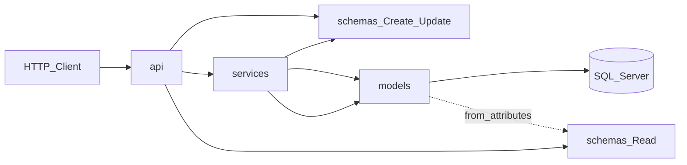

# MTF Layer Responsibilities (api, model, schema, service)

Each entity (e.g. **tenant**) is split into four layers with a strict call direction: API handles HTTP, schemas validate JSON, services hold business logic and DB access, models map to SQL Server tables.

For every entity like **tenant**, the repo uses four files under a domain (`mtf/tenant/`):

```
mtf/tenant/
├── api/tenant.py                 ← HTTP routes
├── models/tenant.py              ← SQLAlchemy table mapping
├── schemas/tenant.py             ← Pydantic request/response shapes
└── services/tenant_service.py    ← business logic + database
```

**Call direction (one way only):**



Defined in [CONVENTIONS.md](CONVENTIONS.md) — Layering section.

---

## 1. Model (`models/tenant.py`)

**What it is:** SQLAlchemy class that mirrors one database table.

**Responsibility:** Persistence shape only — column names, types, nullability, SQL schema.

| Does | Does not |
|------|----------|
| Map to `tenant.tenant` table via `__tablename__`, `__table_args__ = {"schema": "tenant"}` | Validate HTTP JSON |
| Declare columns: `id`, `name`, `subdomain`, `is_deleted`, `row_version`, etc. | Contain business rules |
| Match live SSMS DDL in [database_schema_v1.sql](database_schema_v1.sql) | Generate ULIDs or run queries |

Example: [`mtf/tenant/models/tenant.py`](../mtf/tenant/models/tenant.py) — class `Tenant(Base)` with `Mapped[str]` columns.

Think of it as: **“What the row looks like in SQL Server.”**

---

## 2. Schema (`schemas/tenant.py`)

**What it is:** Pydantic `BaseModel` classes for API input and output.

**Responsibility:** Validate and serialize JSON at the HTTP boundary.

| Variant | Used for |
|---------|----------|
| `TenantCreate` | POST body — fields the client may send; excludes server-generated `id`, `row_version` |
| `TenantUpdate` | PATCH body — optional fields + required `row_version` for optimistic locking |
| `TenantRead` | GET/POST response — full row exposed to clients |
| `TenantSubdomainRead` | Slimmer public projection for login pages |

| Does | Does not |
|------|----------|
| Field types, max lengths, `Literal` enums (`TenantStatus`, `TenantPlanType`) | Talk to the database |
| `@field_validator` for input rules | Import SQLAlchemy models directly |
| `from_attributes=True` on Read schemas so FastAPI can build JSON from ORM objects | Generate IDs or enforce tenant isolation |

Example: [`mtf/tenant/schemas/tenant.py`](../mtf/tenant/schemas/tenant.py).

Think of it as: **“What JSON the client sends and receives.”**

---

## 3. Service (`services/tenant_service.py`)

**What it is:** Application logic class — receives a SQLAlchemy `Session`, returns model instances.

**Responsibility:** All business rules, queries, transactions, and error raising.

| Does | Does not |
|------|----------|
| CRUD: `list_tenants`, `get_tenant`, `create_tenant`, `update_tenant`, `soft_delete_tenant` | Define HTTP routes or status codes directly (uses exception helpers) |
| Generate ULIDs via `generate_id()` on create | Parse raw HTTP requests |
| Filter `is_deleted == False` on queries | Know about FastAPI `Depends` |
| Check `row_version` on update → `409` on mismatch | Return Pydantic models (returns SQLAlchemy `Tenant`; FastAPI converts via `TenantRead`) |
| Handle `IntegrityError` (duplicate subdomain → `TENANT_SUBDOMAIN_CONFLICT`) | |
| Set `created_by`, `updated_by`, `deleted_by`, timestamps | |

Example from [`mtf/tenant/services/tenant_service.py`](../mtf/tenant/services/tenant_service.py):

```python
def create_tenant(self, data: TenantCreate, *, created_by: str | None = None) -> Tenant:
    tenant = Tenant(id=generate_id(), created_by=created_by, **data.model_dump(exclude_none=True))
    self._db.add(tenant)
    self._db.commit()
    ...
```

Think of it as: **“What the app actually does with the data.”**

---

## 4. API (`api/tenant.py`)

**What it is:** FastAPI `APIRouter` — URL paths, HTTP methods, auth, status codes.

**Responsibility:** HTTP adapter only. Thin glue between the web and the service.

| Does | Does not |
|------|----------|
| Declare routes: `GET /`, `POST /`, `PATCH /{tenant_id}`, `DELETE /{tenant_id}` | Run SQL or build queries |
| Wire `Depends(get_db)`, `Depends(require_scope("system"))`, pagination | Generate ULIDs |
| Use `response_model=TenantRead` so FastAPI serializes responses | Duplicate business rules already in service |
| Map 404 via `raise_if_not_found(tenant, "TENANT_TENANT", ...)` | Commit transactions |
| HTTP-specific checks (e.g. public subdomain lookup returns 403 if tenant inactive) | |

Example from [`mtf/tenant/api/tenant.py`](../mtf/tenant/api/tenant.py):

```python
@router.post("/", response_model=TenantRead, status_code=status.HTTP_201_CREATED)
def create_tenant(
    payload: TenantCreate,
    current_user: CurrentUser = Depends(require_scope("system")),
    service: TenantService = Depends(get_tenant_service),
) -> TenantRead:
    return service.create_tenant(payload, created_by=current_user.user_id)
```

Mounted in [main.py](../main.py) as `/api/tenant/...`.

Think of it as: **“How the outside world talks to the app.”**

---

## How a create request flows (tenant example)

1. **Client** → `POST /api/tenant/` with JSON body
2. **API** validates body into `TenantCreate` (schema)
3. **API** checks auth (`require_scope("system")`), calls `TenantService.create_tenant`
4. **Service** builds `Tenant` model, assigns ULID, commits to DB
5. **API** returns ORM `Tenant`; FastAPI serializes to `TenantRead` (schema) as JSON `201`

---

## Quick comparison table

| Layer | Technology | Knows about HTTP? | Knows about DB table? | Contains business logic? |
|-------|------------|-------------------|----------------------|--------------------------|
| **api** | FastAPI router | Yes | No (via service only) | Minimal (HTTP-only guards) |
| **schema** | Pydantic | Shapes only | No | Input validation only |
| **service** | Python class + Session | Via exception helpers | Yes (via models) | **Yes — main home** |
| **model** | SQLAlchemy | No | Yes (column mapping) | No |

---

## Exceptions and layout notes

- **`audit`** domain uses a **flat** layout (`models.py`, `schemas.py`, `service.py` at domain root) — same responsibilities, different folder shape.
- **`shared/`** holds cross-cutting pieces: config, DB session, JWT, `exceptions.py`, `deps.py` — not per-entity.
- When adding a new entity: add all four files, then register the router in `api/__init__.py` and export from each `__init__.py` (see CONVENTIONS “New entity” checklist).

---

## Where to read more

- Authoritative rules: [CONVENTIONS.md](CONVENTIONS.md) — Layering, Models, Schemas, API sections
- Workflow for new endpoints: [../.cursor/skills/mtf-add-api-endpoint/SKILL.md](../.cursor/skills/mtf-add-api-endpoint/SKILL.md)
