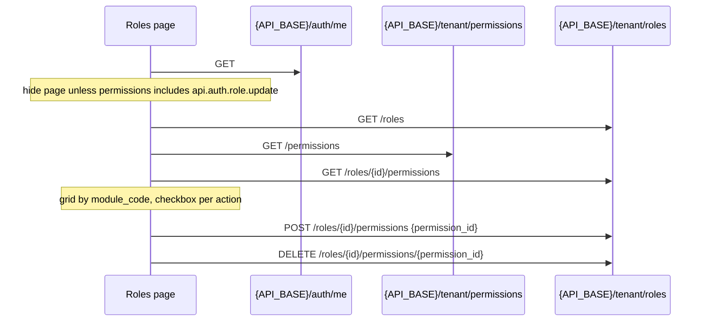

# Prompt — Tenant Role Admin frontend (React)

Paste this whole file into a **Cursor chat whose workspace is `deevoflow_react`**.

This is the **frontend contract** for tenant Role Admin. The HTTP already lives in
`deevo_mt_framework_backend` (`mtf/tenant/api/tenant_rbac.py`). React calls those URLs with the
JWT. There is no DeevoFlow wrapper.

**Backend first.** The DeevoFlow API must already expose `GET /api/v1/tenant/permissions`.
That check is [DEEVOFLOW_TENANT_ROLE_ADMIN.md](DEEVOFLOW_TENANT_ROLE_ADMIN.md) (workspace
`deevoflow_backend`). If OpenAPI is missing that path, stop; do not mock it.

Portal Role Admin is **later**. Do not build account/portal role screens.

Adapt §0 to this repo's folder names. Keep the API facts (§3–§8) unchanged.

Do **not** implement this from `deevo_mt_framework_backend`. Do **not** change the RBAC backend.
Do **not** implement this in `deevoflow_backend`.

Backend source of truth:

- `../deevo_mt_framework_backend/mtf/tenant/api/tenant_rbac.py`
- `../deevo_mt_framework_backend/mtf/auth/schemas/permission.py` (`TenantPermissionRead`)
- `../deevo_mt_framework_backend/mtf/auth/schemas/role.py` (`RoleRead`, `TenantRoleCreate`)
- `../deevo_mt_framework_backend/mtf/auth/schemas/role_permission.py`
- `../deevo_mt_framework_backend/mtf/auth/schemas/user_role.py`
- `../deevo_mt_framework_backend/sql/auth_rbac_seed_tenant_catalog_v1.sql`

DeevoFlow already remounts tenant routes:

```python
from mtf.tenant.api import router as mtf_tenant_router
app.include_router(mtf_tenant_router, prefix="/api/v1")
```

If `/api/v1/tenant/permissions` is missing in OpenAPI, stop. Do not call MTF on port 8000 from
this React app. Do not add a DeevoFlow proxy under `/api/v1/crm/...`.

---

## 0. Adapt before use

| Placeholder | Meaning | Example (DeevoFlow React) |
|---|---|---|
| `{ORIGIN}` | Host only | `http://localhost:8010` |
| `{API_BASE}` | Origin + prefix where `mtf.tenant` is mounted | `http://localhost:8010/api/v1` |
| HTTP client | Authenticated client (Bearer + refresh) | `src/lib/api.ts` |
| `{FEATURE_DIR}` | Feature folder | `src/features/roles/` |
| Roles page | Settings → Roles | `/settings/roles` (or the app's Settings child) |
| User page | Existing staff user detail | the page that already lists `/tenant/users` |
| `tenantId` | Auth-store tenant — **query keys only, never sent** | `useAuthStore().tenantId` |
| UI kit | App components | lucide-react + shadcn + TanStack Query + Zod |

**DeevoFlow React today:** staff users already exist. This work adds a Roles screen and a role
assignment block on the user page. Do not replace membership `role` (`admin` / `member`) on
create/update user.

---

## 1. Product rules (never violate)

1. **Never send `tenant_id`, `user_id` (except in the path), `user_scope`, or permission codes
   in a JWT.** Tenant comes from the access token. Query params and bodies for these APIs must
   not include `tenant_id`.
2. **Hide the Roles screen unless `GET {API_BASE}/auth/me` → `permissions` contains
   `api.auth.role.update`.** A 403 is not the primary hide. If the user navigates anyway, show
   the existing forbidden UI from `AUTH_FORBIDDEN`.
3. **Platform templates are read-only.** `RoleRead.is_system === true` (and `tenant_id` is
   `null`) means `tenant_admin` (thin: Role Admin + admin menus) and empty `tenant_member`
   (unused for new members). List them. Show their grants. Do **not** PATCH, DELETE, grant,
   or revoke on them. Create a **custom** role (`is_system` false) to tick boxes.
4. **Tenants never create or edit the permission catalog.** No POST/PATCH/DELETE on
   `/tenant/permissions`. The grid is GET-only. Grant/revoke by `permission_id` on a custom
   role.
5. **No copy-from-template in this slice.** There is no `source_role_id`. A new custom role
   starts with zero grants. The admin ticks boxes, then save posts/deletes grants.
6. **Grant by `permission_id`, never by composing a code string.** The catalog row's `id` is
   the POST body. Do not send `code`.
7. **Membership string stays on the user form.** `POST/PATCH {API_BASE}/tenant/users` still
   uses `role: "admin"|"member"`. Extra RBAC roles are
   `POST {API_BASE}/tenant/users/{user_id}/roles` with `{ "role_id" }`. Do not mix the two
   fields in one control.
8. **Do not call system catalog APIs** (`{API_BASE}/auth/permissions`, `{API_BASE}/auth/roles`).
   Those are `user_scope=system` only.
9. **The backend filters the menu.** `GET {API_BASE}/nav/modules` and `…/items` already return
   only what the signed-in user may open (report grants, `menu.*` and `screen.*`
   permissions). This screen does not filter the sidebar. After a role, report grant or
   default Member change that affects the signed-in user, refetch the nav queries.
10. **Do not invent a bulk save endpoint.** Save is a sequence of existing POST/DELETE grant
    calls. There is no `PUT /roles/{id}/permissions`.

---

## 2. How the pieces fit



Typical sequence:

1. After login, `GET {API_BASE}/auth/me`. If `api.auth.role.update` is missing, do not show
   Settings → Roles.
2. Open Roles → `GET {API_BASE}/tenant/roles` and `GET {API_BASE}/tenant/permissions`.
3. Select a role → `GET {API_BASE}/tenant/roles/{role_id}/permissions`. Join grants to the
   catalog by `permission_id`.
4. Custom role: tick/untick → on Save, POST missing grants and DELETE extra grants.
5. On a staff user page: `GET {API_BASE}/tenant/users/{user_id}/roles` and assign/revoke
   custom (and template) roles with POST/DELETE.

---

## 3. Calling conventions

**Base URL:** `{API_BASE}/tenant`. Use the app's authenticated HTTP client.

**Who can call:** JWT `user_scope=tenant` **and** `api.auth.role.update`. Missing grant →
**403 `AUTH_FORBIDDEN`**. Missing/expired token → **401 `AUTH_UNAUTHORIZED`**.

**Error shape** (handled errors):

```json
{ "detail": { "code": "AUTH_FORBIDDEN", "message": "Insufficient permissions" } }
```

| Code | Status | When | UI |
|---|---|---|---|
| `AUTH_UNAUTHORIZED` | 401 | missing / bad / expired JWT | existing refresh / login redirect |
| `AUTH_FORBIDDEN` | 403 | caller lacks `api.auth.role.update` | hide screen; if already open, forbidden page |
| `AUTH_ROLE_FORBIDDEN` | 403 | edit/grant on a platform template, or escalation (grant a code the actor does not hold) | toast the message; do not retry |
| `AUTH_ROLE_NOT_FOUND` | 404 | unknown / other-tenant / deleted role | go back to the list |
| `AUTH_ROLE_CONFLICT` | 409 | duplicate custom `code`, or last-admin (cannot remove the last `api.auth.role.update` holder) | toast; keep the previous grants |
| `AUTH_ROLE_PERMISSION_CONFLICT` | 409 | grant already exists | treat as already checked; refetch |
| `AUTH_ROLE_PERMISSION_NOT_FOUND` | 404 | revoke of a grant that is gone | refetch the role grants |
| `AUTH_ROLE_PERMISSION_BAD_REQUEST` | 400 | permission scope mismatch (should not happen with this catalog) | toast; refetch |
| `TENANT_USER_NOT_FOUND` | 404 | assign to a user who is not live staff | stay on users list |
| `AUTH_USER_ROLE_CONFLICT` | 409 | user already holds that role | treat as assigned; refetch |
| `AUTH_ROLE_CONFLICT` (row_version) | 409 | PATCH role `row_version` stale | refetch role and retry |

`row_version` is raw bytes. JSON is **base64**. Send back the exact string from the last GET.
Do not invent it.

Empty catalog is **200** `[]`. Empty role list is **200** `[]`.

---

## 4. API — grantable catalog (grid source)

`GET {API_BASE}/tenant/permissions`

No query params. No pagination. Ordered `module_code`, `sort_order`, `resource_name`, `code`.

```json
[
  {
    "id": "01JRACMTFPM000000000000001",
    "code": "screen.lead.view",
    "resource_type": "screen",
    "resource_code": "lead",
    "action": "view",
    "module_code": "CRM",
    "resource_name": "Lead",
    "sort_order": 10
  }
]
```

| Field | Use |
|---|---|
| `id` | POST body `permission_id` (26-char ULID) |
| `code` | Debug / a11y only. Do not parse it to invent rows |
| `resource_type` | `screen` \| `menu` \| `api` — optional badge |
| `resource_code` | Group key inside a module (e.g. `lead`) |
| `action` | Checkbox column: `view` `create` `update` `delete` `export` (also `import` `approve` if present) |
| `module_code` | Section header (`CRM`, `WF`, `GENERAL`). Already uppercase |
| `resource_name` | Row label (`Lead`, `Inbox`) |
| `sort_order` | Row order inside the module. Keep API order |

**Seeded tenant rows you should see (do not hard-code the list; still render unknown modules):**

| `module_code` | Resources | Actions |
|---|---|---|
| `CRM` | Lead, Account, Contact, Opportunity, Task, Note | view, create, update, delete, export |
| `WF` | Inbox / Mine / All / Templates (`menu.wf_*.view`) | view |
| `GENERAL` | Role admin (`api.auth.role.update`) | update |

`api.system.role.update` is **not** in this catalog (`is_tenant_grantable=0`).

---

## 5. API — roles

### List

`GET {API_BASE}/tenant/roles?skip=0&limit=100`

Returns platform tenant templates **and** this tenant's custom roles. Ordered
`is_system` desc, then `code`.

| Field | Use |
|---|---|
| `id` | Path id. React key |
| `code` | Stable key (`tenant_admin`, `sales_lead`) |
| `name` | List label |
| `is_system` | `true` → Template, read-only |
| `tenant_id` | `null` on templates; your tenant on custom |
| `is_active` | Dim inactive custom roles |
| `row_version` | Required on PATCH |

### Create custom role

`POST {API_BASE}/tenant/roles` → **201**

```json
{ "code": "sales_lead", "name": "Sales Lead", "description": null }
```

`code` must match `^[a-z][a-z0-9_]*$`. Duplicate in this tenant → **409 `AUTH_ROLE_CONFLICT`**.
The new role has **no** grants until the admin ticks boxes.

### Get / rename custom role

`GET {API_BASE}/tenant/roles/{role_id}`

`PATCH {API_BASE}/tenant/roles/{role_id}` needs `{ "row_version": "<base64>", "name": "...", "description": "...", "is_active": true }`.
Template → **403 `AUTH_ROLE_FORBIDDEN`**.

### Delete custom role

`DELETE {API_BASE}/tenant/roles/{role_id}` → **204**. Template → 403. Last-admin (role still
grants `api.auth.role.update` and no other holder remains) → **409 `AUTH_ROLE_CONFLICT`**.

---

## 6. API — grants on a role

### List

`GET {API_BASE}/tenant/roles/{role_id}/permissions?skip=0&limit=100`

Each row is a **grant**, not a catalog row:

```json
{
  "id": "01J…",
  "role_id": "01J…",
  "permission_id": "01JRACMTFPM000000000000001",
  "user_scope": "tenant",
  "is_active": true,
  "is_deleted": false
}
```

Join `permission_id` to the catalog `id`. Ignore `is_deleted` (list is live). If `limit` is too
small, raise it or page until empty; the seeded catalog is larger than a handful of rows.

### Grant

`POST {API_BASE}/tenant/roles/{role_id}/permissions` → **201**

```json
{ "permission_id": "01JRACMTFPM000000000000001" }
```

Template role → **403 `AUTH_ROLE_FORBIDDEN`**. Actor does not hold that code → **403
`AUTH_ROLE_FORBIDDEN`** ("Cannot grant a permission you do not hold"). Already granted →
**409 `AUTH_ROLE_PERMISSION_CONFLICT`**.

### Revoke

`DELETE {API_BASE}/tenant/roles/{role_id}/permissions/{permission_id}` → **204**

Path uses **catalog `permission_id`**, not the grant row `id`. Revoking the last
`api.auth.role.update` on the last admin role → **409 `AUTH_ROLE_CONFLICT`**.

---

## 7. API — assign roles to a staff user

Staff list (already exists; **admin** membership gates **writes** on this list, not Role Admin):

- `GET {API_BASE}/tenant/users`
- `GET {API_BASE}/tenant/users/{user_id}`

Role assignments (Role Admin permission):

| Method | Path | Body |
|---|---|---|
| GET | `{API_BASE}/tenant/users/{user_id}/roles` | |
| POST | `{API_BASE}/tenant/users/{user_id}/roles` | `{ "role_id": "<26-char ULID>" }` **201** |
| DELETE | `{API_BASE}/tenant/users/{user_id}/roles/{role_id}` | **204** |

POST body is only `role_id`. Do not send `account_id`. These assignments are tenant staff
(`account_id` null). Last-admin revoke → **409 `AUTH_ROLE_CONFLICT`**. User already holds the
role → **409 `AUTH_USER_ROLE_CONFLICT`**. Do not POST/DELETE platform `tenant_admin` /
`tenant_member` — those follow membership dual-write only.

Show membership `role` (`admin` / `member`) as the existing field. Show RBAC roles as a
separate multi-select of `GET /tenant/roles`. Dual-write maps **`admin` → `tenant_admin`**
only; **`member` gets no template** (product access comes only from assigned custom roles).
Do not offer a control that removes `tenant_admin` while membership is still `admin`.


## 8. Report grants (required for CRM list menus)

CRM Leads/Accounts/Contacts/Opportunities/Tasks are **nav report items**. Screen ticks alone
do not show them. Build the Reports tab using
[`ROLE_ADMIN_REPORT_GRANTS_FRONTEND_PROMPT.md`](ROLE_ADMIN_REPORT_GRANTS_FRONTEND_PROMPT.md).

Summary:

- Catalog: `GET {API_BASE}/tenant/reports` (Role Admin; not the filtered `GET /reports`)
- Grants: `GET/POST {API_BASE}/tenant/roles/{role_id}/reports` and
  `PATCH/DELETE …/reports/{report_id}` — POST `{ "report_id", "can_view", "can_export" }`

Do not use `{API_BASE}/auth/roles/{id}/default-reports`.

---

## 9. Screen layout (suggested)

**Settings → Roles**

- Left: role list. Badge **Template** when `is_system`. Button **New role** (custom only).
- Right, custom role: name/description, then a grid:
  - Section per `module_code`.
  - Row per `resource_name` (group catalog rows that share `module_code` + `resource_code`).
  - Columns: each distinct `action` present in that resource (missing action → empty cell, not
    an unchecked box that would POST).
  - Checkbox checked iff a grant exists for that catalog `id`.
- Right, template: same grid, all controls disabled. Caption: "Platform template. Create a
  custom role to change grants."
- Save: compute diff vs last fetched grants. POST each new `permission_id`. DELETE each
  removed `permission_id`. Then refetch. Disable Save on templates.

**User page**

- Keep membership `role` (`admin` | `member` only).
- Add "Roles" chips from `GET /users/{id}/roles` joined to `GET /roles`.
- Add/remove with POST/DELETE. `tenant_admin` from dual-write should look locked; it changes
  only through membership `admin` ↔ `member`. Members start with zero roles until you assign
  custom ones (e.g. CRM).

---

## 10. What not to build

- Portal Role Admin (`tenant_account` / `account_admin`).
- Copy role from template (`source_role_id`).
- Permission catalog editor.
- Putting grants in login/refresh tokens.
- Calling `{API_BASE}/auth/permissions`.
- Hiding nav items yourself from `permissions[]` (the nav API already does it).
- Dropping `tenant_user.role`.
- A "default Member permissions" switch (retired — members never get `tenant_member`).
- Wrapping these routes in DeevoFlow.

---

## Suggested steps (one per user message in the React chat)

1. **Gate** — read `GET {API_BASE}/auth/me`. Add Settings → Roles only when
   `api.auth.role.update` is present. Unauthenticated 401 uses existing session handling.
2. **List + catalog** — `GET /tenant/roles` and `GET /tenant/permissions`. Render the template
   vs custom list and a read-only grid for the selected role.
3. **Custom role CRUD** — create / rename / delete. Tests: template PATCH is 403; duplicate
   `code` is 409.
4. **Save grants** — checkbox diff → POST/DELETE. Non-grantable escalation 403 and last-admin
   409 show a toast; refetch.
5. **Assign on user page** — GET/POST/DELETE `/tenant/users/{id}/roles` without touching
   membership `role`.
6. Stop. Reports tab, portal, and copy-from-template are later.

## Security checklist

- Tenant id from JWT only.
- Roles page hidden without `api.auth.role.update`.
- Templates not editable.
- No catalog POST/PATCH/DELETE.
- No `source_role_id`.
- Grant body is `{ "permission_id" }` only.
- Member without the grant cannot open the page (and API is 403).
- Membership values are only `admin` | `member`.
