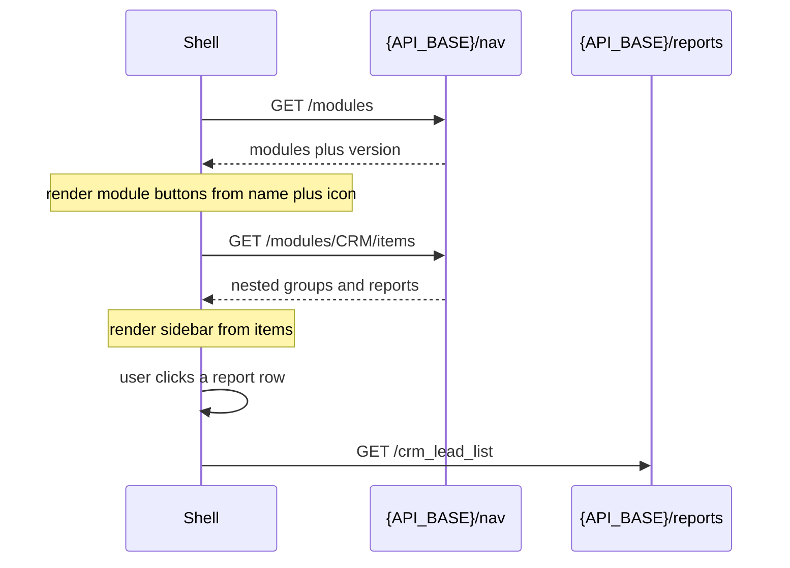

# Prompt — Dynamic navigation frontend (React) for `mtf/nav`

This is the **frontend contract** for the platform menu catalog built in
`deevo_mt_framework_backend` (`mtf/nav`). It is app-neutral: any product that mounts the `nav`
router can drive its shell from it.

**How to use it.** Copy this file into the **React** repo (for DeevoFlow: `deevoflow_react`), then
adapt the copy to that repo's conventions — §0 lists app-specific names. Keep the API facts
(§3–§7) unchanged; they describe the backend exactly as built.

Paste this whole file into a Cursor chat whose workspace is the **frontend** repo. Do **not**
implement this from `deevo_mt_framework_backend`. Do **not** change the nav backend.

Backend source of truth:

- `../deevo_mt_framework_backend/mtf/nav/api/menu.py`
- `../deevo_mt_framework_backend/mtf/nav/schemas/menu.py`
- `../deevo_mt_framework_backend/sql/nav_menu_schema_v1.sql`
- `../deevo_mt_framework_backend/sql/nav_menu_seed_v1.sql`

DeevoFlow already mounts the router:

```python
from mtf.nav.api import router as mtf_nav_router
app.include_router(mtf_nav_router, prefix="/api/v1")
```

If `/api/v1/nav/modules` is missing in OpenAPI, stop and mount it. Do not call MTF on port 8000
from this React app.

---

## 0. Adapt before use

| Placeholder | Meaning | Example (DeevoFlow React) |
|---|---|---|
| `{ORIGIN}` | Host only | `http://localhost:8010` |
| `{API_BASE}` | Origin + prefix where `mtf.nav` is mounted | `http://localhost:8010/api/v1` |
| HTTP client | Authenticated client (Bearer + refresh) | `src/lib/api.ts` (`api` Axios instance) |
| `{FEATURE_DIR}` | Feature folder | `src/features/nav/` |
| Shell | Layout that currently hard-codes CRM / Workflow / Email | `src/components/common/layout/Sidebar.tsx`, `AppLayout.tsx`, `Topbar.tsx` |
| Report runner | Existing generic report page | `/rpt/:reportKey` → `ReportRunnerPage` |
| `tenantId` | Auth-store tenant — **query keys only, never sent** | `useAuthStore().tenantId` |
| `userScope` | `tenant` \| `tenant_account` from the store — **never sent** | `useAuthStore().userScope` |
| UI kit | App components | lucide-react + shadcn + TanStack Query + Zod |

**DeevoFlow React today:** there is no module top-bar. Everything lives in the left
`Sidebar.tsx` (hard-coded CRM, CRM Preview, Workflows, Intelligence, Admin, Email, Chat).
`Topbar.tsx` is user/logout only. §6 says how to map the two APIs onto that shell without
throwing away Admin / Intelligence until they exist in `nav.menu_module`.

If the app already has a reports UI, **reuse** `/rpt/:reportKey`. Do not build a second report
page for menu clicks.

---

## 1. Product rules (never violate)

1. **Menu comes from the API.** Do not hard-code module names `CRM` / `Workflow` / `Email`, and do
   not hard-code submenu labels or paths for those modules. Adding a row in SQL must change the
   shell without a new React file.
2. **Never send `tenant_id`, `user_id`, `user_scope`, `T`, or `P`.** The JWT already has
   `user_scope` (tenant vs portal), `tenant_id`, and `user_id`. The backend reads them from the
   token. Query params and body for these two GETs must stay empty.
3. **Nav is convenience, not security.** Showing a report in the menu does not mean the user can
   run it. Opening a report still uses existing `GET {API_BASE}/reports/{report_key}` (and run).
   If that returns 404, show the report not-found UI. Do not hide items by `/me` grants in this
   work — user-level menu filtering is a later backend change.
4. **Only two nav endpoints.** No POST/PATCH/DELETE. No combined tree endpoint.
5. **Branch on `item_type`.** `report` → navigate to the report runner. `group` → section with
   `children`. Any other `item_type` → skip (do not crash).
6. **Use `report_key`, never ids.** The JSON has no `id`, `module_id`, `parent_id`, or `report_id`.
7. **Do not invent routes from item `code`.** `CRM.LEADS` is a menu key, not a URL. The URL is
   `/rpt/{report_key}` (e.g. `/rpt/crm_lead_list`).
8. **Do not replace the generic report catalog** (`/rpt`) or transaction screens (`/txn/...`).
   Those stay.

---

## 2. How the pieces fit



Typical sequence after login (login and `GET {API_BASE}/auth/me` already exist):

1. `GET {API_BASE}/nav/modules` → draw modules.
2. Select a module (or default to the first) → `GET {API_BASE}/nav/modules/{code}/items`.
3. Click a `report` row → existing runner at `/rpt/{report_key}`.
4. Switch module → fetch that module's items. Do not prefetch every module unless it is cheap and
   still keyed separately.

---

## 3. Calling conventions

**Base URL:** `{API_BASE}/nav`. Use the app's authenticated HTTP client. `module_code` goes through
`encodeURIComponent`.

**Who can call:** any logged-in JWT (`system`, `tenant`, `tenant_account`). The catalog is filtered
**only** by `user_scope` on the token. A tenant staff token sees tenant modules (`CRM`, `WF`,
`EMAIL` once seeded). A portal token sees portal modules (none seeded in v1 → empty list, not 404).

**Parameters the frontend sends**

| Call | Path params | Query | Body | Headers |
|---|---|---|---|---|
| List modules | none | none | none | `Authorization: Bearer <access_token>` |
| Module items | `module_code` (from `modules[].code`) | none | none | same Bearer token |

`module_code` may be `crm` or `CRM`; the server uppercases it. Prefer the `code` value from the
list response.

**Error shape** (handled errors):

```json
{ "detail": { "code": "NAV_MODULE_NOT_FOUND", "message": "Module not found" } }
```

| Code | Status | When | UI |
|---|---|---|---|
| `AUTH_UNAUTHORIZED` | 401 | missing / bad / expired JWT | existing refresh / login redirect |
| `NAV_MODULE_NOT_FOUND` | 404 | unknown code, inactive, deleted, or other scope's module | stay on previous module; toast "Module not found" |

Empty catalog is **200** `{ "modules": [], "version": "1970-01-01T00:00:00.000Z" }` — not 404.
Empty submenu is **200** `{ "items": [] }` for a live module.

---

## 4. API 1 — list modules (module strip)

`GET {API_BASE}/nav/modules`

```json
{
  "version": "2026-11-16T08:44:31.000Z",
  "modules": [
    { "code": "CRM", "name": "CRM", "icon": "crm", "sort_order": 10 },
    { "code": "WF", "name": "Workflow", "icon": "workflow", "sort_order": 20 },
    { "code": "EMAIL", "name": "Email", "icon": "mail", "sort_order": 30 }
  ]
}
```

| Field | Use |
|---|---|
| `version` | Cache hint. Include it in the React Query key's data; if you store the last version, you may skip a refetch when it matches. Do not send it back. |
| `modules[].code` | Selected-module key and path for API 2. React key. |
| `modules[].name` | Button / tab label. **Never** hard-code "CRM". |
| `modules[].icon` | Map to a lucide (or app) icon. Unknown or `null` → default (e.g. `LayoutGrid`). |
| `modules[].sort_order` | API already sorts. Keep the array order. |

Do not display `code` to the user unless you need it for debugging.

**Seeded tenant icons (map these; still default-unknown):**

| `icon` | Suggested lucide |
|---|---|
| `crm` | `Users` |
| `workflow` | `GitBranch` |
| `mail` | `Mail` |
| `users` | `UserPlus` |
| `building` | `Building2` |
| `contact` | `ContactRound` |
| `handshake` | `Target` |
| `checklist` | `ListTodo` |
| `folder` | `Folder` |
| `user` | `User` |
| `list` | `List` |
| `inbox` | `Inbox` |
| `send` | `Send` |

---

## 5. API 2 — submenu and reports for one module

`GET {API_BASE}/nav/modules/{module_code}/items`

```json
{
  "version": "2026-11-16T08:44:31.000Z",
  "module": { "code": "CRM", "name": "CRM", "icon": "crm", "sort_order": 10 },
  "items": [
    {
      "code": "CRM.LEADS",
      "item_type": "report",
      "label": "Leads",
      "icon": "users",
      "report_key": "crm_lead_list",
      "sort_order": 10,
      "children": []
    },
    {
      "code": "WF.TASKS",
      "item_type": "group",
      "label": "Tasks",
      "icon": "folder",
      "report_key": null,
      "sort_order": 10,
      "children": [
        {
          "code": "WF.TASKS.MINE",
          "item_type": "report",
          "label": "My tasks",
          "icon": "user",
          "report_key": "tenant_user_list",
          "sort_order": 10,
          "children": []
        }
      ]
    }
  ]
}
```

`items` is **level 1 only**. Nesting is `children` (max one extra level: group → reports). Reports
always have `children: []`. Groups may have an empty `children` array — hide empty groups in the
UI if it looks better; do not fetch extra data.

| Field | Use |
|---|---|
| `module` | Echo of the list row. Safe to use if the list cache is stale. |
| `item_type` | `report` or `group` only from the DB. Skip anything else. |
| `label` | Visible text. |
| `report_key` | Set on `report`. Always `null` on `group`. Navigate to `/rpt/{report_key}` (encode the key). |
| `code` | React `key`. Do not parse it into a path. |
| `icon` | Same mapping as modules. |

**Click handler for `report`:**

```ts
navigate(`/rpt/${encodeURIComponent(item.report_key)}`)
```

That is the existing generic runner. Do **not** send `tenant_id`. Do **not** open `/crm/leads`.

**Active state:** a sidebar row is active when `location.pathname === /rpt/${encodeURIComponent(report_key)}`.

---

## 6. Shell mapping (DeevoFlow React)

### Keep (local chrome — not in `nav` yet)

Leave these as they are (or move them, but do not pretend they came from the API):

- Dashboard `/`
- Reports catalog `/rpt` (index, not a `:reportKey`)
- Intelligence `*`
- Admin `/admin/users`, `/admin/portal-accounts`
- Chat `/chat`
- Settings `/settings`

### Replace (must come from the API)

Remove the hard-coded arrays and blocks in `Sidebar.tsx`:

- `crmChildren` and the **CRM** collapsible
- **CRM (Preview)** (`/rpt/crm_lead_list`) — Leads will appear under API CRM as `crm_lead_list`
- `workflowChildren` and the **Workflows** collapsible
- `bottomNavItems` **Email** entry (`/email`)

Chat can stay as local chrome (not in the nav seed). If you keep Chat in the sidebar, put it with
Admin / Settings, not inside the API module list.

### Recommended layout

1. **Module strip** — render `modules[]` as tabs/buttons (in `Topbar` left side, or at the top of
   `Sidebar`). Selecting one sets `selectedModuleCode`.
2. **Sidebar body** — for the selected module, render API `items` (groups + reports).
3. **Then** the local chrome (Dashboard, Reports catalog, Intelligence, Admin, Chat, Settings).

Default `selectedModuleCode` to `modules[0].code` when the list loads. Persist it in memory (or
sessionStorage) for the tab. If the user is already on `/rpt/crm_lead_list`, you may keep CRM
selected; do not reverse-engineer module from `report_key` unless you already have that module's
items cached.

Do **not** fetch items for every module up front unless the payload stays tiny; v1 is one items
call per selected module.

### What not to delete

- Routes under `/crm/*` (old entity pages) may remain in the router so bookmarks do not 404. Stop
  linking them from the shell.
- `/wf/*` workflow builder pages: same — they are not in the nav seed (WF items are placeholder
  **reports**). Keep those routes; they can stay under local chrome or a later seed change. Do not
  mix hard-coded `/wf/templates` into the API-driven WF sidebar.

---

## 7. Types, client, hooks (follow `features/rpt`)

Suggested layout:

```
src/features/nav/
  api/navApi.ts
  schemas/navApiSchema.ts
  types/nav.types.ts
  hooks/useNavModules.ts
  hooks/useNavModuleItems.ts
  components/ModuleStrip.tsx
  components/ModuleSidebar.tsx
```

Zod (must match the JSON; extra keys ignored):

```ts
const navModuleSummarySchema = z.object({
  code: z.string().min(1),
  name: z.string(),
  icon: z.string().nullable(),
  sort_order: z.number().int(),
})

const navMenuItemSchema: z.ZodType<NavMenuItem> = z.lazy(() =>
  z.object({
    code: z.string().min(1),
    item_type: z.string(), // do not enum-reject unknown types; skip in the UI
    label: z.string(),
    icon: z.string().nullable(),
    report_key: z.string().nullable(),
    sort_order: z.number().int(),
    children: z.array(navMenuItemSchema),
  }),
)

const navModuleListSchema = z.object({
  version: z.string(),
  modules: z.array(navModuleSummarySchema),
})

const navModuleItemsSchema = z.object({
  version: z.string(),
  module: navModuleSummarySchema,
  items: z.array(navMenuItemSchema),
})
```

Client (same pattern as `reportsApi.ts`):

```ts
const base = '/api/v1/nav'

export async function listNavModules(signal?: AbortSignal) {
  const response = await api.get(`${base}/modules`, { signal })
  return navModuleListSchema.parse(response.data)
}

export async function getNavModuleItems(moduleCode: string, signal?: AbortSignal) {
  const response = await api.get(
    `${base}/modules/${encodeURIComponent(moduleCode)}/items`,
    { signal },
  )
  return navModuleItemsSchema.parse(response.data)
}
```

React Query keys must include `tenantId` (and `userScope` if the same browser can switch) **only as
cache identity**, never as request params:

```ts
queryKey: ['nav', 'modules', tenantId, userScope]
queryKey: ['nav', 'items', tenantId, userScope, moduleCode]
```

`staleTime` can be 60s; `retry: false` on 404. Enabled for items only when `moduleCode` is set.

Wire `ModuleStrip` + `ModuleSidebar` into `AppLayout` / `Sidebar`. Keep mobile `Sheet` behavior.

---

## 8. Not in the API / not this work

- Sending `tenant_id`, `user_id`, `T`/`P`, or `user_scope`
- Filtering the menu with `GET /auth/me` `reports[]` / `permissions[]`
- Portal-specific modules (empty list is correct today)
- Admin CRUD for menu rows
- A single `GET /nav/menu` tree
- New report pages, new CRM entity pages, or DeevoFlow backend routes
- Changing `mtf/nav` or the SQL seed

---

## 9. Tests

Follow existing MSW + vitest style (`features/rpt`, `features/txn`).

- List modules: tenant fixture returns CRM / WF / EMAIL; labels come from JSON, not literals in the
  component (assert `getByRole('button', { name: 'Workflow' })` against fixture `name`).
- Clicking CRM calls `GET /api/v1/nav/modules/CRM/items` (path only; no query).
- Clicking a report item navigates to `/rpt/crm_lead_list` (or whatever `report_key` the fixture
  used).
- Unknown `item_type` is not rendered and does not throw.
- Group with children renders nested links; group `report_key` is not a link.
- 404 on items shows a toast / inline error and does not blank the whole app.
- Request spy: query string empty; body empty; `Authorization` present (or asserted via the shared
  client mock).
- Portal fixture with `{ modules: [] }` does not crash; CRM hard-coded links are gone.

---

## 10. Done when

- Hard-coded CRM / CRM Preview / Workflows / Email **menu entries** are gone from `Sidebar.tsx`.
- After login, the shell shows whatever `GET /api/v1/nav/modules` returns.
- Selecting CRM shows Leads / Accounts / … from items (when those reports exist) and each opens
  `/rpt/{report_key}`.
- Network tab: only Bearer token + `module_code` on the items URL; no `tenant_id`.
- Intelligence, Admin, Chat, Settings, Dashboard, `/rpt` catalog still reachable as local chrome.
- Unit/MSW tests above pass.

Restart DeevoFlow if it was running before `mtf.nav` was mounted. Seed
`sql/nav_menu_seed_v1.sql` must already be applied on `deevo_app_dev2` (it has been on the local
dev database used to build the APIs).
