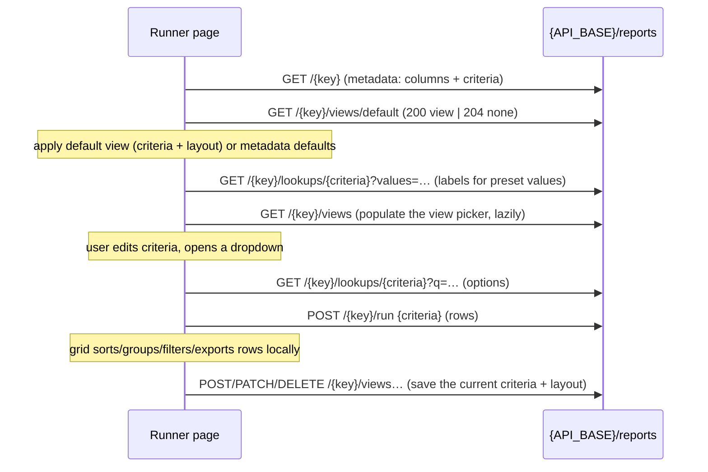

# Prompt — Reports frontend (React) for the generic report writer (`mtf/rpt`)

This is the **frontend contract** for the generic report writer built in
`deevo_mt_framework_backend` (`mtf/rpt`). It is app-neutral: any product that mounts the `rpt`
router can build its reports UI from it.

**How to use it.** Copy this file into the frontend repo, then adapt the copy to that repo's
conventions (UI kit, HTTP client, folder layout, routing, test tooling) — §0 lists everything that
is app-specific. Keep the API facts (§3–§9) unchanged; they describe the backend exactly as built.

The backend side of the same contract is `prompts/rpt/REPORT_API_PROMPT.md` in this repo; the design
rationale is `docs/REPORTING_FRAMEWORK_CONTEXT.md`.

Report → report drilldown (actions + resolve) is a follow-on:
[REPORT_FRONTEND_REPORT_DRILLDOWN_PROMPT.md](REPORT_FRONTEND_REPORT_DRILLDOWN_PROMPT.md).

---

## 0. Adapt before use

| Placeholder | Meaning | Example |
|---|---|---|
| `{API_BASE}` | Host app URL + the prefix it mounts the `rpt` router under | `http://localhost:8000/api` (this repo's `main.py` mounts at `/api`; other apps may use `/api/v1`) |
| HTTP client | The app's authenticated client (attaches the Bearer token, refreshes it) | a shared Axios instance |
| `{FEATURE_DIR}` | Where the feature lives | `src/features/rpt/` |
| Routes | Catalog and runner pages | `/rpt` and `/rpt/:reportKey` |
| `tenantId` | Current tenant from the app's auth store — used only in query keys, **never sent** | `authStore.tenantId` |
| `userScope` | `tenant` (staff) or `tenant_account` (portal user) from the auth store | `authStore.userScope` |
| UI kit / grid | The app's components; examples assume **TanStack Table** + **TanStack Query** + **Zod** | |

If the app already has a reports feature, **update it** to this contract rather than starting a
second one. Remove anything built for older drafts of this API (see §11 "Not in the API").

---

## 1. Product rules (never violate)

1. **Generic, metadata-driven.** One catalog page and one runner page serve every report. Adding a
   report in SQL must not need a new React file, route, type, or `if (reportKey === …)`.
2. Branch only on API metadata: `control_type`, `data_type`, `has_lookup`, column flags,
   `can_edit`. Never on `report_key`.
3. **Never send `tenant_id`** (or `user_id`) anywhere. The backend takes both from the JWT.
4. **Two different filters — don't conflate them:**
   - **Criteria** (`report.criteria[]`) — filled before Run, sent to the server, executed by SQL.
   - **Grid column filters** (`column.is_filterable`) — client-side on rows already loaded. Never
     call the API for these.
5. **No server paging of report rows.** `/run` returns the full filtered result (capped by
   `max_rows`). Sorting, grouping, column filters, subtotals and exports happen in the browser.

---

## 2. How the pieces fit



Vocabulary:

| Term | Meaning |
|---|---|
| **Report** | One `report_key` (e.g. `tenant_account_list`). `scope_type` `system` (all tenants) or `tenant` (one tenant's custom report). |
| **Columns** | Fields the run returns, with display/sort/group/aggregate/filter flags. |
| **Criteria** | Inputs sent to the server before running (status, date range, …). |
| **Lookup** | Server-provided `{value, label}` options for a `dropdown`/`multiselect` criterion. |
| **Saved view** | A named bundle of **criteria + layout** (columns, sort, group, aggregates) at one tier: `user` (mine), `tenant` (shared with my tenant), `system` (built-in, read-only). |
| **Default view** | The view applied automatically when the report opens: my default → tenant default → system default → metadata defaults. |

---

## 3. Calling conventions

**Base URL:** `{API_BASE}/reports`. Use the app's authenticated HTTP client. Path segments
(`report_key`, `criteria_key`, `view_id`) go through `encodeURIComponent`.

**Who can call:** any JWT with a tenant and `user_scope` `tenant` (staff) or `tenant_account`
(portal user). Both can read reports, run them, and manage their **own** saved views. Only tenant
staff with tenant role `owner`/`admin` can manage **tenant-shared** views. `system` users and tokens
without a tenant get `403 AUTH_FORBIDDEN` on every endpoint.

**Repeated query params.** `values` is a repeated parameter: `?values=a&values=b`. Axios's default
serializer sends `values[]=a&values[]=b`, which the backend **does not** read. With Axios ≥ 1.x pass
`paramsSerializer: { indexes: null }` on lookup calls; with `fetch`, build `URLSearchParams` and
`append` each value.

**Error shape** (every handled error):

```json
{ "detail": { "code": "REPORT_CRITERIA_INVALID", "message": "Invalid report criteria",
              "fields": { "created_date": "'from' must be on or before 'to'" } } }
```

`fields` appears only on `*_INVALID` codes. Request-body schema failures caught by FastAPI itself
(missing `row_version`, unknown body key, empty `view_name`, `q` too long) come back as **FastAPI's
default 422**: `{ "detail": [ { "loc": [...], "msg": "...", "type": "..." } ] }` — handle a
`detail` array too.

| Code | Status | When | UI response |
|---|---|---|---|
| `AUTH_FORBIDDEN` | 403 | wrong scope / no tenant; or not allowed to manage that view tier | toast; for view writes: "You don't have permission to change this view" |
| `REPORT_NOT_FOUND` | 404 | report key not visible to this tenant | not-found page |
| `REPORT_LOOKUP_NOT_FOUND` | 404 | criterion has no lookup | field shows "Options unavailable" (metadata bug) |
| `REPORT_VIEW_NOT_FOUND` | 404 | view deleted or not yours | refetch views, toast "That view no longer exists" |
| `REPORT_CRITERIA_INVALID` | 422 | criteria failed validation | show `fields[criteria_key]` under each criterion |
| `REPORT_LAYOUT_INVALID` | 422 | saved layout invalid (keys like `sort[0]`) | toast with first message (UI bug if it happens) |
| `REPORT_VIEW_CONFLICT` | 409 | duplicate view name in the tier; stale `row_version`; concurrent default | see §8.6 |
| `REPORT_EXECUTION_FAILED` | 500 | proc failed, timed out (server limit 60 s), or returned wrong columns | "The report could not be executed." + Retry; the server logs details |

Write three small helpers for this feature: `reportErrorMessage(error)` (reads `detail.message`;
joins `msg`s for a `detail` array; falls back to a generic message), `reportErrorCode(error)` and
`reportErrorFields(error): Record<string, string>`. Many apps' generic error helpers return the HTTP
client's own message ("Request failed with status code 422") before looking at `detail` — check
before reusing one.

All JSON is `snake_case`. List endpoints return bare arrays, no wrapper objects.

---

## 4. Endpoint reference

Examples use the sample reports seeded by `docs/rpt_seed_sample_report.sql` (§13). Row values are
illustrative.

### 4.1 `GET {API_BASE}/reports` — catalog

Lists **all** reports this tenant can see (system reports + this tenant's own reports), ordered by
`display_name`. No query parameters and no paging — the response is always the full list.

```ts
type ReportScopeType = 'system' | 'tenant'
interface ReportSummaryRead {
  report_key: string          // stable public key, used in URLs
  display_name: string
  description: string | null
  scope_type: ReportScopeType // 'tenant' = this tenant's custom report
}
// Response: ReportSummaryRead[]   (bare array)
```

```json
[
  { "report_key": "tenant_account_list", "display_name": "Account List",
    "description": "All accounts for the current tenant, filterable by type, status, and created date.",
    "scope_type": "system" },
  { "report_key": "tenant_user_list", "display_name": "Staff Users",
    "description": "Staff users of the current tenant with role, status, and last login.",
    "scope_type": "system" }
]
```

UI: table with Name, Scope badge (`Custom` for `tenant`), Description; client-side search over
`display_name` + `report_key`; row click → runner route. Don't build paging UI.

### 4.2 `GET {API_BASE}/reports/{report_key}` — metadata

Everything the runner needs to render the criteria panel and the grid. Static: it does **not**
include saved views or rows.

```ts
type ReportDataType = 'string' | 'int' | 'decimal' | 'date' | 'datetime' | 'bool'
type ReportControlType = 'text' | 'number' | 'date' | 'daterange' | 'dropdown' | 'multiselect' | 'bool'
type ReportAggregateType = 'sum' | 'avg' | 'count' | 'min' | 'max'

interface ReportColumnRead {
  column_name: string            // key in every run row
  display_name: string           // header text
  data_type: ReportDataType
  display_order: number          // already sorted, but sort again defensively
  is_displayable: boolean        // false → never show as a column (value may still be in rows)
  is_default_visible: boolean    // initial visibility when no view is applied
  is_sortable: boolean
  is_groupable: boolean
  is_filterable: boolean         // client-side column filter
  is_aggregatable: boolean
  default_aggregate_type: ReportAggregateType | null  // subtotal function in grouped mode
  display_format: string | null  // 'currency' | 'percent' | 'MM/dd/yyyy' | … (see §9)
  default_width: number | null   // px
}

interface ReportCriteriaRead {
  criteria_key: string           // key in the criteria object you send
  display_name: string           // field label
  data_type: ReportDataType
  control_type: ReportControlType
  has_lookup: boolean            // true → options come from §4.3
  default_value: string | null   // literal string, e.g. "active", "false"; see §5.3
  is_required: boolean
  display_order: number
}

interface ReportDetailRead {
  report_key: string
  display_name: string
  description: string | null
  scope_type: ReportScopeType
  default_max_rows: number       // server row cap for /run
  columns: ReportColumnRead[]
  criteria: ReportCriteriaRead[]
}
```

Errors: `404 REPORT_NOT_FOUND`. Proc names are never exposed.

Abbreviated example (`tenant_account_list`):

```json
{
  "report_key": "tenant_account_list", "display_name": "Account List",
  "description": "…", "scope_type": "system", "default_max_rows": 20000,
  "columns": [
    { "column_name": "name", "display_name": "Name", "data_type": "string", "display_order": 20,
      "is_displayable": true, "is_default_visible": true, "is_sortable": true, "is_groupable": false,
      "is_filterable": true, "is_aggregatable": false, "default_aggregate_type": null,
      "display_format": null, "default_width": 240 },
    { "column_name": "account_type", "display_name": "Type", "data_type": "string", "display_order": 30,
      "is_displayable": true, "is_default_visible": true, "is_sortable": true, "is_groupable": true,
      "is_filterable": true, "is_aggregatable": true, "default_aggregate_type": "count",
      "display_format": null, "default_width": 120 },
    { "column_name": "created_at", "display_name": "Created", "data_type": "datetime", "display_order": 80,
      "is_displayable": true, "is_default_visible": true, "is_sortable": true, "is_groupable": false,
      "is_filterable": true, "is_aggregatable": false, "default_aggregate_type": null,
      "display_format": "MM/dd/yyyy", "default_width": 130 }
  ],
  "criteria": [
    { "criteria_key": "account_type", "display_name": "Account Type", "data_type": "string",
      "control_type": "multiselect", "has_lookup": true, "default_value": null,
      "is_required": false, "display_order": 10 },
    { "criteria_key": "status", "display_name": "Status", "data_type": "string",
      "control_type": "dropdown", "has_lookup": true, "default_value": "active",
      "is_required": false, "display_order": 20 },
    { "criteria_key": "created_date", "display_name": "Created Date", "data_type": "date",
      "control_type": "daterange", "has_lookup": false, "default_value": null,
      "is_required": false, "display_order": 30 }
  ]
}
```

### 4.3 `GET {API_BASE}/reports/{report_key}/lookups/{criteria_key}` — dropdown options

Options for a criterion with `has_lookup: true`. Every lookup is search-capable; there is **no**
lookup-mode field.

| Query | Type | Default | Notes |
|---|---|---|---|
| `q` | string ≤ 200 chars | — | search text; matching is done by the SQL proc (typically "label contains") |
| `values` | repeated string | — | resolve labels for already-selected values: `?values=a&values=b` |
| `limit` | int | 50 | clamped to 1–200. When `values` is sent without `limit`, the default grows to `len(values)` |

```ts
interface ReportLookupOption { value: string; label: string } // value is ALWAYS a string
interface ReportLookupRead { items: ReportLookupOption[]; has_more: boolean }
```

`has_more: true` → more matches exist beyond `limit` (show "Keep typing to narrow results").

Errors: `404 REPORT_LOOKUP_NOT_FOUND`, `500 REPORT_EXECUTION_FAILED`, FastAPI 422 if `q` > 200 chars
(trim client-side).

```http
GET {API_BASE}/reports/tenant_account_list/lookups/account_type
→ {"items":[{"value":"customer","label":"Customer"},{"value":"vendor","label":"Vendor"},
            {"value":"employee","label":"Employee"}],"has_more":false}

GET {API_BASE}/reports/tenant_account_list/lookups/account_type?limit=2
→ {"items":[…2 items…],"has_more":true}

GET {API_BASE}/reports/tenant_account_list/lookups/account_type?values=vendor&values=customer
→ {"items":[{"value":"customer","label":"Customer"},{"value":"vendor","label":"Vendor"}],"has_more":false}

GET {API_BASE}/reports/portal_user_list/lookups/account_id?q=acme
→ {"items":[{"value":"01KRX…","label":"A001 - Acme Global"}],"has_more":false}
```

The value and label can differ completely (the `account_id` lookup returns ULIDs labelled
"CODE - Name"). Lookup values are strings even for `int` criteria (e.g. `"42"`). Send them back
as-is — the server converts them to the criterion's `data_type`.

### 4.4 `POST {API_BASE}/reports/{report_key}/run` — execute

```ts
interface ReportRunRequest {
  criteria?: Record<string, unknown>  // keyed by criteria_key; shapes in §5. Default {}
  max_rows?: number | null            // ceiling request; omit to use default_max_rows
}
interface ReportRunRead {
  report_key: string
  row_count: number                   // === rows.length
  truncated: boolean                  // more rows matched than were returned
  rows: Record<string, string | number | boolean | null>[]
}
```

- Row keys are exactly the report's `column_name`s (including non-displayable ones).
- `max_rows` is clamped to `1…default_max_rows`. Sending a bigger number is safe but pointless.
- `truncated: true` → banner: "Showing the first N rows. Narrow the criteria to see all results."

Value encoding in `rows` by column `data_type`:

| `data_type` | JSON | Example |
|---|---|---|
| `string` | string | `"Acme Global"` |
| `int` | number | `75` |
| `decimal` | number | `125000.0` |
| `date` | `"YYYY-MM-DD"` | `"2026-11-15"` — a calendar date: **don't** pass through `new Date()` (timezone shift); format the parts |
| `datetime` | ISO 8601, no offset, **UTC** | `"2026-08-01T10:15:00"` → display with `new Date(value + 'Z')` |
| `bool` | boolean | `true` |
| any | `null` | missing value |

Errors: `404 REPORT_NOT_FOUND`, `422 REPORT_CRITERIA_INVALID` (map `fields` onto criteria inputs),
`500 REPORT_EXECUTION_FAILED`.

```http
POST {API_BASE}/reports/tenant_account_list/run
{ "criteria": { "account_type": ["customer", "vendor"], "status": "active",
                "created_date": { "from": "2026-01-01" } } }

→ { "report_key": "tenant_account_list", "row_count": 2, "truncated": false,
    "rows": [ { "account_code": "A001", "name": "Acme Global", "account_type": "customer",
                "status": "active", "email": "ap@acme.example", "phone": null,
                "is_active": true, "created_at": "2026-03-14T16:05:22" }, … ] }
```

### Saved view object (returned by §4.5–4.8)

```ts
type SavedViewScope = 'system' | 'tenant' | 'user'

interface ReportSavedViewRead {
  id: string                       // ULID
  view_name: string
  scope_type: SavedViewScope
  is_default: boolean              // default within its own tier
  can_edit: boolean                // may this caller PATCH/DELETE it (computed per caller)
  criteria: Record<string, unknown>   // same shapes as /run criteria (§5), already normalized
  layout: ReportLayout                // §6; always has all four arrays
  row_version: string              // base64, opaque — send back unchanged on PATCH
  updated_at: string               // ISO 8601 UTC, no offset
}
```

### 4.5 `GET {API_BASE}/reports/{report_key}/views` — list views

Every active view the caller can see on this report: system views (system reports only), all of
the tenant's shared views, and **only the caller's own** user views. Ordered: user tier, tenant
tier, system tier, then `view_name`. Not paginated. Response: `ReportSavedViewRead[]`.

Errors: `404 REPORT_NOT_FOUND`.

### 4.6 `GET {API_BASE}/reports/{report_key}/views/default` — effective default

Returns the first default in **user → tenant → system** order as `200 ReportSavedViewRead`, or
**`204 No Content`** (empty body) when none exists. On 204 fall back to metadata defaults
(`is_default_visible`, `default_width`, `default_value`). Axios gives `status === 204` and
`data === ''` — check the status, don't parse the body.

Errors: `404 REPORT_NOT_FOUND`.

### 4.7 `POST {API_BASE}/reports/{report_key}/views` — create view

```ts
interface ReportSavedViewCreate {
  view_name: string                  // trimmed, 1–200 chars
  scope_type: 'user' | 'tenant'      // 'system' always → 403
  criteria?: Record<string, unknown> // default {}; validated exactly like /run
  layout?: Partial<ReportLayout>     // default {}; validated against column flags (§6)
  is_default?: boolean               // default false; true clears the previous default in that tier
}
// 201 → ReportSavedViewRead
```

Unknown body keys are rejected (FastAPI 422). Who may create:

| `scope_type` | Allowed for |
|---|---|
| `user` | any tenant staff or portal user (the view belongs to the caller) |
| `tenant` | tenant staff whose tenant role is **owner** or **admin**. The JWT doesn't carry the tenant role, so offer the option to all staff (`userScope === 'tenant'`, never portal users) and handle `403` |
| `system` | nobody via API (built-in views are authored in SQL) |

Errors: `403 AUTH_FORBIDDEN`, `404 REPORT_NOT_FOUND`, `409 REPORT_VIEW_CONFLICT` ("A saved view with
this name already exists" in that tier), `422 REPORT_CRITERIA_INVALID` / `REPORT_LAYOUT_INVALID`.

```http
POST {API_BASE}/reports/tenant_account_list/views
{ "view_name": "Active customers", "scope_type": "user",
  "criteria": { "account_type": ["customer"], "status": "active" },
  "layout": { "columns": [ { "column_name": "name", "visible": true, "width": 260 },
                           { "column_name": "email", "visible": true, "width": null },
                           { "column_name": "phone", "visible": false, "width": null } ],
              "sort": [ { "column_name": "created_at", "direction": "desc" } ],
              "group": [ "status" ], "aggregates": [] },
  "is_default": true }
→ 201 { "id": "01M4…", "view_name": "Active customers", "scope_type": "user", "is_default": true,
        "can_edit": true, "criteria": {…}, "layout": {…}, "row_version": "AAAAAAAAB9E=",
        "updated_at": "2026-10-02T21:52:00" }
```

### 4.8 `PATCH {API_BASE}/reports/{report_key}/views/{view_id}` — update view

```ts
interface ReportSavedViewUpdate {
  row_version: string                // REQUIRED, base64 from the last read of this view
  view_name?: string                 // trimmed, 1–200
  criteria?: Record<string, unknown> // replaces the stored criteria WHOLE (not merged)
  layout?: Partial<ReportLayout>     // replaces the stored layout WHOLE
  is_default?: boolean               // true → clears the tier's previous default; false → unset
}
// 200 → ReportSavedViewRead (new row_version)
```

`scope_type` cannot change (sending it → 422). To move a view between tiers, create a new one.
Omitted fields stay as they are; a body with only `row_version` changes nothing.

Errors: `404 REPORT_VIEW_NOT_FOUND` (not visible to you — including other users' views),
`403 AUTH_FORBIDDEN` (visible but `can_edit` is false), `409 REPORT_VIEW_CONFLICT` (stale
`row_version`: "Record was modified by another request. Fetch the latest version and retry.", or
duplicate name), `422` as for create.

### 4.9 `DELETE {API_BASE}/reports/{report_key}/views/{view_id}` — delete view

No body. `204 No Content`. Soft delete. If it was the default, **no other view is promoted** — the
next `GET /views/default` falls back down the chain. Same `404` / `403` rules as PATCH.

---

## 5. Criteria values — the exact rules

The same validator runs on `/run`, `POST /views` and `PATCH /views`, so build the criteria object
one way everywhere.

### 5.1 Shapes

| `control_type` | Value shape | Notes |
|---|---|---|
| `text`, `number`, `date`, `dropdown`, `bool` | single scalar | |
| `multiselect` | array of scalars | duplicates removed by the server |
| `daterange` | `{ "from"?: …, "to"?: … }` | either bound may be missing/null (open-ended); only `from`/`to` keys allowed |

### 5.2 Scalar types (by `data_type`)

| `data_type` | Accepted | Rejected |
|---|---|---|
| `string` | strings | numbers, booleans |
| `int` | integers, integer strings (`"42"`), whole floats (`42.0`) | `10.75`, `"abc"`, booleans, outside 32-bit range |
| `decimal` | numbers, numeric strings (`"10.50"`) | `NaN`, `Infinity`, booleans |
| `date` | `"YYYY-MM-DD"` (real calendar date) | other formats |
| `datetime` | ISO 8601 (`"2026-10-01T09:00:00"`; offsets are converted to UTC) | other formats |
| `bool` | `true` / `false` only | `"true"`, `1`, `0` |

### 5.3 Empty values and defaults

- `null`, `""`, `[]`, and a range with both bounds empty all mean **"no filter"** — the server drops
  them. Prefer omitting the key, but sending them is harmless.
- A `required` criterion that ends up empty → `422` with `"This field is required"`. Validate
  client-side too so Run is disabled, but always display server `fields` errors.
- Unknown `criteria_key` → `422 "Unknown criterion"`. Strip keys not in the current metadata
  before sending (matters when applying an old saved view — §8.4).
- Range with `from > to` → `422 "'from' must be on or before 'to'"`.
- `default_value` is a **literal string** (`"active"`, `"true"`, `"false"`, a number as text).
  Parse it by `control_type`/`data_type` for the initial form value. Tokens like `@today` are
  **not** supported in V1 — treat unparseable text as no default.
- **`bool` criteria are tri-state when not required: Any (omit) / Yes (`true`) / No (`false`).**
  `false` is a real filter (e.g. `tenant_user_list` "Active = No" returns inactive users only), so
  an unchecked checkbox must not silently send `false`. Use a 3-option segmented control or select,
  initialised from `default_value`. A required `bool` can be a checkbox.

### 5.4 Server-side errors → UI

`422 REPORT_CRITERIA_INVALID` → `detail.fields` is keyed by `criteria_key`. Put each message under
its field; messages are human-readable already ("Must be a whole number", "Item 1: must not be
empty", "'to': Must be a date (YYYY-MM-DD)").

### 5.5 What comes back in a saved view

Saved `criteria` are the **normalized** form: ints as numbers (even if you sent `"42"`), decimals as
numbers, dates as `"YYYY-MM-DD"`, datetimes without offset (UTC), multiselects de-duplicated, empty
criteria absent. Feed them straight into the form state.

---

## 6. Layout — saved-view shape and mapping to the grid

```ts
interface ReportLayout {
  columns:    { column_name: string; visible: boolean; width: number | null }[] // display order
  sort:       { column_name: string; direction: 'asc' | 'desc' }[]              // sort priority
  group:      string[]                                                         // group order
  aggregates: { column_name: string; type: ReportAggregateType }[]
}
```

Server rules (violations → `422 REPORT_LAYOUT_INVALID`, `fields` keyed like `"sort[0]"`):

- every `column_name` must exist on the report; no duplicates within one array;
- `visible: true` needs `is_displayable`; `sort` needs `is_sortable`; `group` needs
  `is_groupable`; `aggregates` need `is_aggregatable`;
- `width` is a positive integer or `null`; `direction` defaults to `asc`; `visible` defaults to `true`;
- the client never sends `version` (the server adds it), and no other keys.

Responses always include all four arrays (missing → `[]`).

**Mapping to grid state.** Keep one UI state object for the grid (TanStack Table names shown):

```ts
interface ReportGridState {
  columnOrder: string[]                       // displayable column_names
  columnVisibility: Record<string, boolean>
  columnSizing: Record<string, number>        // px
  sorting: { id: string; desc: boolean }[]
  grouping: string[]
}
```

Put the conversions in `utils/reportLayout.ts` and unit-test them:

```ts
// grid state → layout (for POST/PATCH)
function toLayout(state: ReportGridState, report: ReportDetailRead): ReportLayout {
  const displayable = new Set(report.columns.filter(c => c.is_displayable).map(c => c.column_name))
  return {
    columns: state.columnOrder.filter(id => displayable.has(id)).map(id => {
      const width = Math.round(state.columnSizing[id] ?? 0)
      return { column_name: id, visible: !!state.columnVisibility[id], width: width > 0 ? width : null }
    }),
    sort: state.sorting.map(s => ({ column_name: s.id, direction: s.desc ? 'desc' : 'asc' })),
    group: [...state.grouping],
    aggregates: [],   // V1: subtotals use column.default_aggregate_type; fill when the UI lets users pick
  }
}

// layout → grid state (when applying a view)
function fromLayout(layout: ReportLayout, report: ReportDetailRead): ReportGridState
```

`fromLayout` rules: start from `initialGridState(report)` (metadata defaults) so columns added to the
report after the view was saved still appear; order = layout columns first (only ones still
displayable), then remaining displayable columns in `display_order` with `is_default_visible`;
widths `null` → `default_width`; drop sort/group entries whose column lost the flag; keep at least
one visible column.

---

## 7. Lookups — one combobox for every lookup field

Every `dropdown` / `multiselect` with `has_lookup: true` renders the same filterable combobox.
Algorithm:

1. **On open** (not on mount): fetch the first page — `GET …/lookups/{key}?limit=50`.
2. If that response has `has_more: false`, the whole list is loaded: filter it **client-side** as
   the user types (no more requests). Typical for status/type/role lists.
3. If `has_more: true`, typing triggers a **server search**: debounce 300 ms, `?q=<trimmed>&limit=50`,
   cancel stale requests (pass TanStack Query's `signal` to the client), keep previous results while
   loading to avoid flicker. Show "Keep typing to narrow results" while `has_more` stays true; "No
   matches" on empty. Typical for entity lists like accounts.
4. **Labels for selected values** that aren't in the loaded options (defaults, saved views,
   back-navigation): `GET …/lookups/{key}?values=a&values=b` (no `limit` needed). Keep a per-field
   `Map<value, label>` fed by every lookup response so chips/labels never fall back to raw codes.
5. `multiselect` → selected items as removable chips that persist across searches; `dropdown` →
   single value with a clear button when not required.
6. Lookup failure → field disabled with "Options unavailable"; the rest of the panel and Run still
   work.

Always store and send the option **`value`**, never the label.

---

## 8. Saved views — UX and flows

### 8.1 Runner load sequence

1. Fetch metadata (`GET /{key}`).
2. In parallel fetch the default view (`GET /{key}/views/default`).
3. When both settle: initial state = metadata defaults (`initialGridState`, criteria from
   `default_value`); if a default view came back, overlay its criteria (`sanitizeCriteria`, §8.4)
   and `fromLayout(view.layout)`. Remember the applied view as `activeView` (id, name, scope,
   `row_version`, `can_edit`).
4. **Do not auto-run.** Show "Set criteria and run the report" until the user clicks Run.
   (Reports can be expensive; auto-run can be added later as a preference.)
5. Load `GET /views` lazily when the view picker opens (or prefetch after first paint).

### 8.2 View picker (toolbar, left of Run)

- Shows the active view name, or "Default layout" when none, plus a "(modified)" marker when the
  current criteria/layout differ from the applied view (deep-compare the sanitized criteria and
  `toLayout()` output against the view's).
- Menu groups in API order: **My views**, **Shared with tenant**, **Built-in**. Mark the default
  in each tier (star). Selecting a view applies it (criteria + layout) without running.
- "Reset to report defaults" → metadata defaults, clears `activeView`.

### 8.3 Actions

| Action | When enabled | Request |
|---|---|---|
| **Save** | active view and `can_edit` and modified | `PATCH {row_version, criteria, layout}` |
| **Save as…** | always | dialog: name (1–200, trimmed), "Share with everyone in this tenant" (only when `userScope === 'tenant'`), "Make this my default" → `POST` |
| **Rename** | `can_edit` | `PATCH {row_version, view_name}` |
| **Set as default / Remove default** | `can_edit` | `PATCH {row_version, is_default: true \| false}` |
| **Delete** | `can_edit` | confirm → `DELETE`; if it was active, keep the current state but clear `activeView` |

`can_edit` is the only permission signal — never guess roles. Built-in (`system`) views always have
`can_edit: false`; users can still apply them and "Save as" a copy. Members and portal users can't
edit tenant views; owners/admins can.

"Set as default" on a **tenant** view makes it the default for everyone in the tenant who has no
personal default — say so in the menu label ("Set as default for tenant").

After every successful write: update `activeView` from the response (new `row_version`), and
invalidate the views list and default-view queries for that report.

### 8.4 Applying a saved view safely

Report metadata can change after a view was saved. Before putting a view into state:

- `sanitizeCriteria(view.criteria, report)` — drop keys that aren't current `criteria_key`s.
- `fromLayout` already drops columns/flags that no longer apply.
- If anything was dropped, show a subtle note: "Some saved settings no longer apply to this report."

Without this, the next Run or Save fails with `422 Unknown criterion`.

### 8.5 Saving: what to send

- `criteria`: the current criteria with empty values removed, passed through `sanitizeCriteria`.
- `layout`: `toLayout(gridState, report)`.
- Never send `version`, `tenant_id`, `user_id`, `id`, `can_edit`, `updated_at`.

### 8.6 Conflicts (409 `REPORT_VIEW_CONFLICT`)

| Situation | Handling |
|---|---|
| Create/rename with a name that exists in that tier | inline error on the name field: the server message |
| PATCH with stale `row_version` (edited in another tab/by an admin) | refetch views; dialog: "This view was changed elsewhere. Reload it (discard my changes) / Save as a new view" |
| Concurrent default switch (rare) | refetch views + default, toast the message |

Create returns 409 for names; PATCH returns 409 for both — when the PATCH body contained
`view_name`, treat a 409 whose message mentions "name" as a name error, otherwise as stale.

### 8.7 Errors on view writes

`403` → "You don't have permission to change this view" (e.g. a member trying to share with the
tenant). `404 REPORT_VIEW_NOT_FOUND` → refetch views, clear `activeView`, toast.
`422 REPORT_CRITERIA_INVALID` → show field errors in the criteria panel, keep the dialog open.

---

## 9. Grid behaviour and formatting

| Column metadata | Behaviour |
|---|---|
| `is_displayable: false` | never a grid column, never in the column picker, never in `layout.columns` with `visible: true` |
| `is_default_visible` | initial visibility (when no view applies) |
| `is_sortable` | header sort enabled |
| `is_filterable` | client-side column filter |
| `is_groupable` | may be chosen as a group level |
| `is_aggregatable` + `default_aggregate_type` | subtotal/total function in grouped mode (`avg` → TanStack `mean`) |
| `default_width` | initial width; `null` → 150 |
| `display_format` | `currency` (2 dp, USD; `currency:EUR` selects the code) · `percent` (value is already a percentage: `75` → `75%`) · date patterns like `MM/dd/yyyy` → locale date (for `datetime`, the local date of the UTC instant) · otherwise by `data_type` |
| `data_type` fallbacks | `int`/`decimal` → `toLocaleString`; `date` → format the `YYYY-MM-DD` parts without timezone conversion; `datetime` → `new Date(v + 'Z').toLocaleString()`; `bool` → Yes/No; `null` → empty |

Empty successful run → "No rows match these criteria". Show the `truncated` banner. Exports use the
loaded rows and the current layout.

---

## 10. TanStack Query

```ts
['rpt', tenantId, 'catalog']                                    // GET /reports
['rpt', tenantId, 'detail', reportKey]                          // GET /reports/{key}
['rpt', tenantId, 'views', reportKey]                           // GET /views
['rpt', tenantId, 'views', reportKey, 'default']                // GET /views/default
['rpt', tenantId, 'lookup', reportKey, criteriaKey, 'page']     // first page
['rpt', tenantId, 'lookup', reportKey, criteriaKey, 'search', q]
['rpt', tenantId, 'lookup', reportKey, criteriaKey, 'values', sortedValues]
```

- Include `tenantId` in every key so a tenant switch never shows stale data.
- `staleTime`: 5 min for metadata, lookup pages and `values`; 1 min for lookup search.
- Run is a mutation (not cached). Keep the last result in page state.
- View writes are mutations; invalidate the two `views` keys on success.
- `retry: false` for 4xx; at most one retry for network errors.

---

## 11. Suggested structure

Adapt names and folders to the app; the responsibilities matter, not the file names.

| File (under `{FEATURE_DIR}`) | Contents |
|---|---|
| `types/report.types.ts` | API types from §4–§6 plus UI types (`ReportGridState`, criterion form values) |
| `schemas/reportApiSchema.ts` | Zod schemas for every response (layout arrays required) |
| `api/reportsApi.ts` | `listReports`, `getReport`, `getReportLookup(reportKey, criteriaKey, {q, values, limit}, signal)`, `runReport`, `listViews`, `getDefaultView` (→ `null` on 204), `createView`, `updateView`, `deleteView`, the three error helpers (§3) |
| `hooks/useReports.ts` | catalog, detail, run |
| `hooks/useReportLookup.ts` | §7 |
| `hooks/useSavedViews.ts` | list, default, create, update, delete |
| `utils/reportCriteria.ts` | `parseDefault`, `initialCriteria`, `criteriaPayload` (drops empties), `sanitizeCriteria`, client-side required check |
| `utils/reportLayout.ts` | `initialGridState`, `toLayout`, `fromLayout`, `isViewModified` |
| `utils/reportFormat.ts` | §9 formatting |
| `components/ReportCatalogPage.tsx` | §4.1 UI |
| `components/ReportRunnerPage.tsx` | load sequence, `activeView`, Run, truncated banner, errors |
| `components/ReportCriteriaPanel.tsx` + `ReportLookupField.tsx` | controls by `control_type`, tri-state bool, server field errors |
| `components/ReportResultsGrid.tsx` + customization panel | columns, sort, group, subtotals, exports |
| `components/ReportViewPicker.tsx` + `SaveViewDialog.tsx` | §8.2–8.3 |

**Not in the API** (remove if an older implementation has them): a `lookup_mode` field;
comma-separated `values`; `400` for bad criteria (it is `422`); "endpoint not available" fallbacks
for run, lookups or saved views; server-side paging of rows; `skip`/`limit` on the catalog.

---

## 12. Mock fixtures and tests

Base mock fixtures (MSW or equivalent) on the sample reports in `docs/rpt_seed_sample_report.sql`
so mocked and live behaviour match — fetch their metadata once from a running backend and paste it.
Add one mock-only report with a **required** criterion and a **large lookup** (500 generated items,
honouring `has_more`, `q` and `values`) to exercise server search.

- The lookup handler must read repeated `values` (`url.searchParams.getAll('values')`) and fail the
  test if it sees `values[]`.
- Views: in-memory store per report implementing list order, default precedence, `can_edit`,
  `row_version` bumping (a new base64 string per write), 409 on duplicate name / stale
  `row_version`, 204 for no default.

Tests:

1. Catalog renders names and the `Custom` badge for tenant reports.
2. Runner renders criteria from metadata in `display_order`; Run is disabled while a required
   criterion is empty.
3. Run sends `{criteria}` with empty values omitted, values not labels, tri-state bool omitted on
   "Any"; grid shows headers from `display_name` and formatted values (currency, date without
   timezone shift, UTC datetime).
4. `422 REPORT_CRITERIA_INVALID` shows the message under the right criterion.
5. `truncated: true` shows the banner.
6. Lookup: small list loads on open and filters locally (no second request); large list issues
   `?q=` after debounce; selected chips keep labels; preset values resolve via repeated `values`.
7. Default view (200) applies criteria + layout on load; 204 uses metadata defaults; no auto-run.
8. Save as (user) → POST body has `layout` from `toLayout`; picker shows it under "My views".
9. Save is not offered on a view with `can_edit: false`; built-in views can be "Save as".
10. Stale `row_version` 409 → conflict dialog; duplicate name 409 → inline name error.
11. Delete the default view → picker no longer marks a default; reload uses the next tier.
12. `toLayout` / `fromLayout` / `sanitizeCriteria` unit tests (round-trip, dropped columns, new
    columns appended, widths rounded/null).

---

## 13. Manual checklist (live)

Prerequisites: backend running with `docs/rpt_schema_v5.sql` and `docs/rpt_seed_sample_report.sql`
applied. Log in as a tenant **owner/admin**, separately as a tenant **member**, and as a **portal
user**. The five sample reports are system reports over framework tables, so they exist in every
app: `tenant_account_list`, `tenant_account_summary`, `tenant_account_address_list`,
`tenant_user_list`, `portal_user_list`.

- [ ] The catalog lists the five sample reports (plus any app-specific ones).
- [ ] `tenant_account_list`: Account Type options are Customer/Vendor/Employee; Status starts at
      `active` (its `default_value`); Run returns the tenant's active accounts.
- [ ] Select two account types → the network tab shows `values=…&values=…` (not `values[]`) when
      labels are resolved after a reload.
- [ ] Created Date From after To → error under Created Date (server 422).
- [ ] `tenant_user_list`: Active = Any / Yes / No give all / active / inactive users.
- [ ] `portal_user_list`: the Account combobox shows "CODE - Name" labels; selecting one sends the
      account id.
- [ ] `tenant_account_summary`: group by Type → Accounts/Active/Inactive subtotal as sums.
- [ ] Hide columns, reorder, group, sort → Save as "My accounts" (mine, default) → reload → layout
      and criteria restored, not run.
- [ ] As owner: Save as with "Share with tenant" → visible to the member under "Shared with
      tenant"; the member sees no Save/Rename/Delete on it.
- [ ] As member: try sharing with the tenant → friendly 403 message. Portal user: no share option.
- [ ] Open the same view in two tabs, save in one, then save in the other → conflict dialog.
- [ ] Delete the default view → the next load falls back to the tenant default or metadata defaults.
- [ ] Request `max_rows` smaller than the result (dev tools or a temporary control) → truncated
      banner.

---

## 14. Acceptance criteria

- No component, route, or type is specific to a `report_key`.
- All nine endpoints are wired with the shapes above; `values` is sent as a repeated parameter.
- Criteria are built once (§5) and reused for Run, Save and Save as; server `fields` errors land on
  the right inputs.
- Saved views: default applied on load, picker with three tiers, Save / Save as / Rename / Set
  default / Delete driven by `can_edit`, `row_version` round-tripped, 409s handled.
- Layout round-trips through `toLayout` / `fromLayout` without losing columns added later.
- Dates never shift by timezone; datetimes are treated as UTC.
- `tenant_id` never appears in any request.
- The tests in §12 pass and the production build passes.
