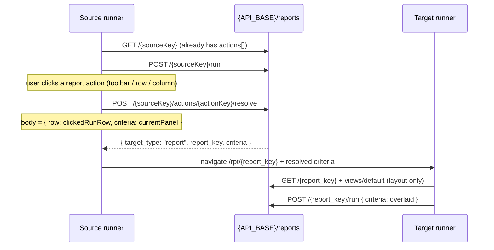

# Prompt — Report → report drilldown (React) for the generic writer (`mtf/rpt`)

This is an **add-on** to [REPORT_FRONTEND_PROMPT.md](REPORT_FRONTEND_PROMPT.md). The catalog,
runner, criteria, lookups, `/run`, and saved views are already built. This file only adds
**report-to-report** navigation from `actions[]`.

The backend is already implemented (`GET /reports/{key}` includes `actions[]`;
`POST /reports/{key}/actions/{action_key}/resolve` returns trusted navigation). Do not invent
endpoints or map columns in React.

**How to use it.** Copy this file into the frontend repo (alongside the reports frontend prompt
if it is already there). Adapt §0 to that repo. Keep the API facts (§3–§6) unchanged.

Screen actions (`target_type: "screen"`) may already work (Lead add/view/edit). Do **not**
rebuild that path. This prompt is **`action_type === "report"` / `target_type === "report"` only**.
If an action click already calls resolve, extend the handler; do not add a second client.

---

## 0. Adapt before use

Same placeholders as the reports frontend prompt:

| Placeholder | Meaning | Example |
|---|---|---|
| `{API_BASE}` | Host + prefix where `mtf.rpt` is mounted | `http://localhost:8010/api/v1` |
| HTTP client | Authenticated Bearer client | shared Axios instance |
| `{FEATURE_DIR}` | Existing reports feature | `src/features/rpt/` |
| Runner route | One generic runner | `/rpt/:reportKey` |
| `tenantId` | Auth-store tenant — **query keys only, never sent** | `authStore.tenantId` |

Inspect the existing reports feature first. Reuse `getReport`, `runReport`, criteria helpers, and
the runner load sequence. Do not create `AccountSummaryDrilldown.tsx` or `if (reportKey === …)`.

---

## 1. Product rules (never violate)

1. **Generic.** One runner handles every drilldown. Seeding a new `rpt.report_action` must not
   need a new React file or a `report_key` branch.
2. Branch only on `action.action_type`, `action.display_location`, and `resolve.target_type`.
   Never on field names except when reading `row[param.source_key]` / applying
   `resolve.criteria[criteria_key]`.
3. **Always call resolve.** `action.report_key` on GET is a **hint** (label / disable). The
   server’s resolve response is authoritative for the target key and criteria.
4. **Never send `tenant_id` or `user_id`.** Never send internal ids (`target_report_id`).
5. **Do not invent mappings.** Extra keys on the clicked row or current criteria are fine to
   send; the server ignores undeclared ones. Do not compute target criteria in the browser.
6. Normal catalog/runner open still **does not auto-run** (existing rule). Drilldown landing
   **does** auto-run once (§5).

---

## 2. How the pieces fit



| Term | Meaning |
|---|---|
| **Action** | A button or cell from `metadata.actions[]`. |
| **Report action** | `action_type === "report"` — opens another report, not a transaction screen. |
| **Resolve** | Server maps declared `params` from the current row and/or criteria. |
| **Drilldown landing** | Opening the target runner with resolved criteria, then one automatic `/run`. |

---

## 3. APIs (already built — do not change)

Auth, `{API_BASE}/reports`, `encodeURIComponent`, error helpers, and Axios
`paramsSerializer: { indexes: null }` are unchanged from the reports frontend prompt.

### 3.1 `actions[]` on `GET {API_BASE}/reports/{report_key}`

The existing metadata response now includes `actions` (empty array if none). Extend the TypeScript
type if it is missing:

```ts
type ReportActionType = "report" | "screen"
type ReportActionLocation = "toolbar" | "row" | "column"
type ReportActionScreenMode = "add" | "view"
type ReportActionParamSource = "column" | "criteria"

interface ReportActionParamRead {
  source_type: ReportActionParamSource
  source_key: string
  target_key: string
}

interface ReportActionRead {
  action_key: string
  display_name: string
  action_type: ReportActionType
  display_location: ReportActionLocation
  trigger_column_key: string | null   // set only when display_location === "column"
  display_order: number
  screen_key: string | null
  screen_mode: ReportActionScreenMode | null
  report_key: string | null           // hint when action_type === "report"
  params: ReportActionParamRead[]
}
```

Internal ids are never returned. If the user cannot see the target report, that action is
**omitted** (not a 403 on GET).

### 3.2 `POST {API_BASE}/reports/{report_key}/actions/{action_key}/resolve`

```ts
interface ReportActionResolveRequest {
  row?: Record<string, unknown>       // default {}
  criteria?: Record<string, unknown>  // default {}
}

type ReportActionResolveRead =
  | {
      target_type: "screen"
      screen_key: string
      mode: "add" | "view"
      params: Record<string, unknown>
    }
  | {
      target_type: "report"
      report_key: string
      criteria: Record<string, unknown>
    }
```

```json
{ "row": { "account_code": "A100", "name": "Acme" },
  "criteria": { "status": "active" } }
```

Extra top-level keys → FastAPI 422. Extra keys **inside** `row` / `criteria` are ignored.

**What to send**

| Action | `row` | `criteria` |
|---|---|---|
| `display_location` `row` or `column` | The **full** `/run` row (`column_name` keys), including hidden columns (`is_displayable: false`) | Current criteria panel — the same object you would send to `/run` |
| `toolbar` | `{}` unless a param has `source_type=column` (unusual) | Current criteria panel |

A declared `source_type=column` param whose key is missing/empty on `row` →
`422 REPORT_ACTION_INVALID` (`detail.fields[source_key]`). Same for `source_type=criteria`
against the panel. Hidden id columns must therefore still be in `/run` rows (product seed).

**Report success**

```json
{ "target_type": "report", "report_key": "tenant_account_summary",
  "criteria": { "account_code": "A100" } }
```

`criteria` is already validated against the **visible** target report (V1 shapes: scalar,
multiselect list, daterange `{from,to}`). Use it as-is. Do **not** wrap scalars in the
browser: a grouped-row value such as `"status": "new"` is sent raw; the server turns it
into `["new"]` when the target criterion is multiselect.

If `target_type === "screen"`, keep the existing transaction navigation. Do not handle screens
in new drilldown-only code except to ignore them.

| Status / code | UI |
|---|---|
| `422 REPORT_ACTION_INVALID` | Toast + `fields[source_key]` (source row/criteria missing) |
| `422 REPORT_CRITERIA_INVALID` | Toast + `fields[criteria_key]` (mapped value failed the **target** contract) |
| `404 REPORT_NOT_FOUND` | Target not visible — toast; stay on the source report |
| `404 REPORT_ACTION_NOT_FOUND` | Action gone / broken — refetch metadata; toast |
| `403 SCREEN_FORBIDDEN` | Screen actions only — existing handler |
| `403 AUTH_FORBIDDEN` | Existing auth handling |
| `401` | Existing refresh / login |

Reuse `reportErrorMessage` / `reportErrorCode` / `reportErrorFields`.

---

## 4. Rendering actions

Sort `actions` by `display_order`, then `action_key`. This prompt only requires behaviour for
`action_type === "report"`. Leave `action_type === "screen"` as it is today.

| `display_location` | UI |
|---|---|
| `toolbar` | Button in the runner toolbar (`display_name`). Enabled after metadata load; does not require a selected row unless a param is `source_type=column`. |
| `row` | Per-row menu or button (`display_name`). Needs a `/run` row. Hide or disable until rows exist. |
| `column` | The cell for `trigger_column_key` is the control (link / button). Same resolve as row (send the **whole** row). If `trigger_column_key` is missing or not a column, skip rendering that action. |

Do not render an action whose `action_type` you do not handle. Do not navigate using
`action.report_key` without resolve.

---

## 5. Landing on the target runner

Navigate to the existing runner route with `report_key` from **resolve**, not from the action hint.

Pass resolved criteria through **router state** (e.g. React Router `location.state`):

```ts
{
  drilldown: true,
  criteria: resolve.criteria,   // object from the server
}
```

Do not put the criteria object in the query string (daterange / lists are awkward and leak).
Browser **Back** returns to the source runner with its previous state if you use normal
`navigate` (push). Do not `replace` unless the product already does that for screens.

**Target load sequence** (replaces “do not auto-run” only when `state.drilldown === true`):

1. `GET /{targetKey}` and `GET /{targetKey}/views/default` as today.
2. **Layout** from the default view (or metadata defaults). Do not skip layout.
3. **Criteria:** start from the same initial criteria as a normal open (`default_value` + default
   view overlay), then **overlay** `state.criteria` (resolved keys win).
4. Resolve lookup labels for any overlaid dropdown/multiselect values (`?values=`).
5. **Auto-run once** with `criteriaPayload` of the overlaid criteria. Show the usual running /
   truncated / 422 field errors on the **target** panel.
6. After that run, the runner is a normal runner: user may change criteria, save views, run
   again. Further runs are manual.

If `state.drilldown` is absent, keep the existing no-auto-run behaviour.

If resolve returns `criteria: {}`, still overlay (no keys) and auto-run — the target runs with
its defaults only.

`404 REPORT_NOT_FOUND` on the target GET → existing not-found page.

---

## 6. Not in this work

- Report `permission_mode` / `report_permission` (next backend slice)
- New backend routes or client-side column→criteria maps
- Report→screen changes (already working)
- Hard-coded CRM / Lead / Account report keys
- Auto-run on a normal catalog open
- Putting `tenant_id` on resolve or `/run`

---

## 7. Suggested frontend build order

One step per request. Inspect `{FEATURE_DIR}` first.

1. Types for `actions[]` + `resolveReportAction(reportKey, actionKey, { row, criteria })`. No UI.
2. Wire report-type actions into the existing toolbar / row / column chrome. Click → resolve only;
   log the response. No navigation yet.
3. On `target_type === "report"`: navigate with `state.drilldown` + `state.criteria`.
4. Target runner: detect drilldown state; overlay criteria; auto-run once; lookup `values`.
5. Errors in §3.2. Manual test.

---

## 8. Manual checklist

Needs a source report that has at least one live `action_type=report` action (product seed, or a
framework sample if one is applied). Do not hard-code the keys — use whatever `GET` returns.

- [ ] Source `GET /{key}` JSON includes `actions` with `action_type: "report"`.
- [ ] Toolbar / row / column controls match `display_location` and `display_order`.
- [ ] Row/column click sends the full `/run` row (hidden id/code columns present in the payload).
- [ ] Resolve network call is `POST …/actions/{action_key}/resolve` with `{ row, criteria }`.
- [ ] Landing URL is `/rpt/{resolve.report_key}` (or the app’s runner route), not a special path.
- [ ] Target criteria panel shows overlaid values; one `/run` fires without clicking Run.
- [ ] Changing a target criterion and clicking Run works as a normal runner.
- [ ] Back returns to the source report.
- [ ] Missing required source key → 422 toast, stay on source.
- [ ] Screen actions still add/view/edit as before.

---

## 9. First user message (frontend repo)

```text
Copy and follow REPORT_FRONTEND_REPORT_DRILLDOWN_PROMPT.md
(report → report only). Adapt §0 to this repo.

The reports runner already exists. Do not add a second reports feature.
Do not hard-code report keys. Do not change screen-action navigation.

Step 1 only: extend GET /reports/{key} types with actions[], and add
resolveReportAction() for POST …/actions/{action_key}/resolve.
No UI yet. Show me the files you will change, then implement.
```
