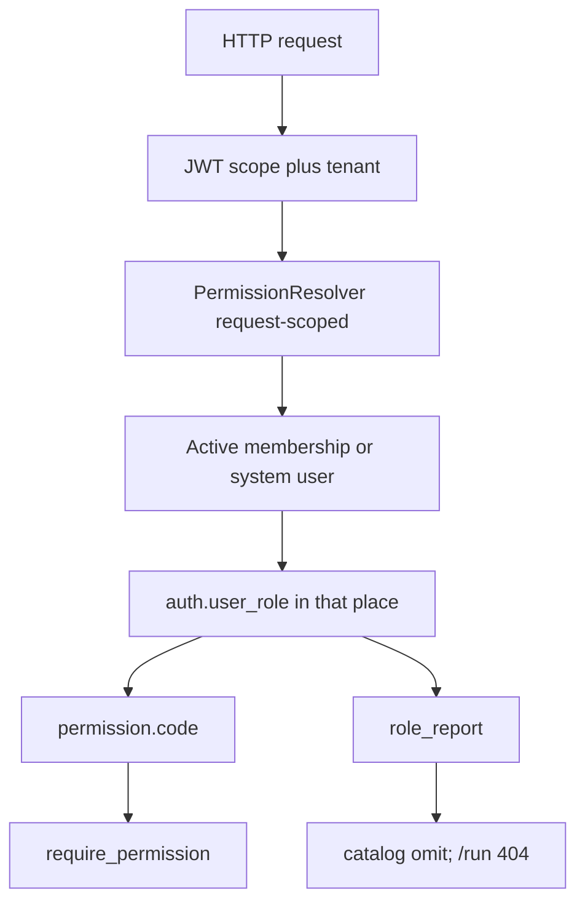

# Roles and Permissions: Development Steps

Nov 8, 2026 · @vinod

Companion to [rbac_database_design.md](rbac_database_design.md) and [auth_rbac_schema_v3.sql](auth_rbac_schema_v3.sql). Schema design stays in those files; this file is the coding order and the rules that must not drift while we build. Remaining review items after step 10: [rbac_review_fixes.md](rbac_review_fixes.md).

## Locked decisions

- **Resolver first.** Unit-test it in isolation; every later step depends on it.
- **No permission codes in the JWT.** Load them per request and memoize for that request only (not for the session).
- **Keep `tenant_user.role` / `tenant_account_user.role` for now.** Dual-write to `user_role`. Dropping the string column in the first slices would break `require_tenant_role` and `ReportViewAuthorizer`.
- **Membership string is master** until RBAC owns the gates. Every write to the string column also updates `user_role` in the same transaction.
- **Reports are the first real enforcement path** in this repo, before DeevoFlow screens and before RBAC CRUD.
- **Do not DROP `txn.screen_permission`** until no tenant still needs the fallback. Product routes keep calling `require_screen_permission`; that helper now prefers RBAC.
- **Platform-wide reports** already exist (`rpt.report_definition.scope_type = 'system'`). Keep `default_role_report`.
- **System users** have no membership row. They resolve `user_role` where `tenant_id` and `account_id` are null. They cannot call tenant endpoints in v1 (`require_scope("tenant")` already denies). Revisit `api.tenant.support` later if impersonation is needed — no ad-hoc bypass.
- **Hidden reports:** catalog omits them; GET-by-id and `/run` return **404**, not 403.
- **Seed is idempotent:** fixed ULID literals, insert only when `code` does not exist.
- **Existing tenants need a backfill** before report enforcement, or they lose access.

### Dual-write map

| Membership table | `role` value | Template `auth.role.code` |
| --- | --- | --- |
| `tenant_user` | `owner`, `admin` | `tenant_admin` |
| `tenant_user` | `member`, `viewer` | `tenant_member` |
| `tenant_account_user` | `admin` | `account_admin` |
| `tenant_account_user` | `member` | `account_member` |

If the template role is missing, fail the write — do not silently skip.

### Last-admin and escalation (assignment CRUD)

- **Admin** means “holds `api.auth.role.update`”, not “code equals `tenant_admin`”.
- Last-admin check and revoke run in one transaction that locks the tenant’s admin assignments (`UPDLOCK, HOLDLOCK`).
- Escalation: an actor cannot grant a permission their resolver set does not contain.

## Coding order

Audit every mutation: `audit_insert` / `audit_update` / `audit_soft_delete`, `schema_name="auth"`, `deleted_at` + `deleted_by`. Pause after step 6 with a live tenant on `deevo_app_dev2`.

| Step | What | Why here |
| --- | --- | --- |
| 0 | Apply DDL | Tables exist before models |
| 1 | Models + docs | Resolver needs ORM; constraint tests prove composite FKs |
| 2 | Resolver + `require_permission` | The core; unit-tested in isolation |
| 3 | Seed | Gives the resolver real data |
| 4 | Backfill existing tenants | Without it, step 6 breaks current users |
| 5 | Onboarding + dual-write | New tenants and existing APIs stay in sync |
| 6 | Report enforcement | End-to-end proof, with a live tenant |
| 7 | `GET /api/auth/me` | UI contract; backend still uses the resolver |
| 8 | Catalog CRUD | Until now, catalog changes go through SQL |
| 9 | Assignment CRUD | Escalation and last-admin live here |
| 10 | DeevoFlow Lead | Product screens after MTF reports work |

### 0. Apply DDL

Run [auth_rbac_schema_v3.sql](auth_rbac_schema_v3.sql) as `deevo_ddl` (GRANT as `dbo` if needed). If `rpt.report_permission` is gone, delete `mtf/rpt/models/report_permission.py` in step 1.

### 1. Models + docs

SQLAlchemy models with composite `ForeignKeyConstraint`s under `mtf/auth/models/`. Live DB test: insert a tenant `role_permission` pointing at a system permission → expect FK failure.

Update [rbac_database_design.md](rbac_database_design.md): real script name; request-scoped load; backfill; dual-write; system-user branch; 404 on hidden reports; close the platform-wide reports open item. Short RBAC v3 pointer in `docs/CONVENTIONS.md`.

### 2. Resolver + `require_permission`

`mtf/auth/services/permission_resolver.py` + `mtf/shared/deps.py`:

- Tenant: membership + `user_role` with `account_id IS NULL`.
- Portal: `tenant_account_user` + match `account_id`.
- System: no membership; `user_role` where `tenant_id` and `account_id` are null. Empty set if none assigned.
- Inactive membership → empty set.
- Request-scoped memoize of the code set (and report grants).
- Missing permission → 403 `AUTH_FORBIDDEN`.

### 3. Seed (idempotent SQL)

[auth_rbac_seed_v3.sql](auth_rbac_seed_v3.sql): literal ULIDs, `IF NOT EXISTS` on `code`. Tenant screen perms you have now (`screen.lead.*` minimum). Platform roles: `tenant_admin`, `tenant_member`, `account_admin`, `account_member`, `system_admin`. `role_permission` + `default_role_report` for system sample reports. Last-admin / catalog permission is `api.auth.role.update` (`api.system.role.update` for system) because `CK_permission_action` does not allow `manage`.

### 4. Backfill existing tenants (blocking)

[auth_rbac_backfill_v3.sql](auth_rbac_backfill_v3.sql): for each live tenant, copy missing `default_role_report` → `role_report`; map each live `tenant_user` / `tenant_account_user` to `user_role` via the dual-write map. Insert only missing rows. This is also the later “apply defaults to all tenants” tool.

### 5. Onboarding + dual-write on existing APIs

- `TenantService.create_tenant`: copy defaults in the same transaction.
- `TenantUserService` / `TenantAccountUserService` create/update/soft-delete: keep the string column as master; sync `user_role` in the same commit.

### 6. Report enforcement (end-to-end proof)

Filter catalog and `/run` by `role_report` for tenant/portal users. Unknown or unauthorized report id → **404**. System users: keep current system catalog rules (not tenant `role_report`). Saved views still use `tenant_user.role` until a follow-up. Prove with a backfilled live tenant.

### 7. `GET /api/auth/me`

Add `permissions: list[str]` and report grants for the UI. Do not add them to the JWT or to `TokenResponse` unless the frontend cannot call `/me`.

### 8. Catalog CRUD (system)

Permission, platform role, `role_permission`, `default_role_report`. Gate with `require_scope("system")` until those endpoints move to `api.system.role.update`.

### 9. Assignment CRUD (tenant)

`user_role` and `role_report` (and tenant-created roles / `role_permission`). Escalation and last-admin as above. Cannot edit `is_system` / platform `tenant_id IS NULL` roles. Until RBAC owns these gates, JWT scope + membership string is enough; `api.auth.role.update` is already in the seed.

### 10. DeevoFlow Lead

Product routes keep `require_screen_permission(screen_key, operation)` so DeevoFlow Lead needs no API rename. `ScreenAccessService` treats a tenant as on RBAC for a screen when live `auth.permission` has `resource_type=screen` and `resource_code=screen_key` **and** the tenant has a live `auth.user_role` row. Then it checks `screen.{key}.{action}` only (`view`→`view`, `add`→`create`, `edit`→`update`, `delete`→`delete`) and returns `403 AUTH_FORBIDDEN`. Otherwise it falls back to `txn.screen_permission` (`403 SCREEN_FORBIDDEN`). Not both-must-pass — an RBAC deny does not consult `screen_permission` or `screen.allow_*`. `GET /api/screens/{screen_key}` uses the same branch for the permissions object. Lead CRUD stays in DeevoFlow.

## Later

`menu.*` permissions, drop membership.role, drop `txn.screen_permission`, service-account `app_user` for automated deletes, optional system support impersonation.

Code-review leftovers (last-admin vs inactive membership, backfill `is_active`, report escalation, portal report grants, tenant-owned report first grant, export helpers, fail-closed report services): [rbac_review_fixes.md](rbac_review_fixes.md).
